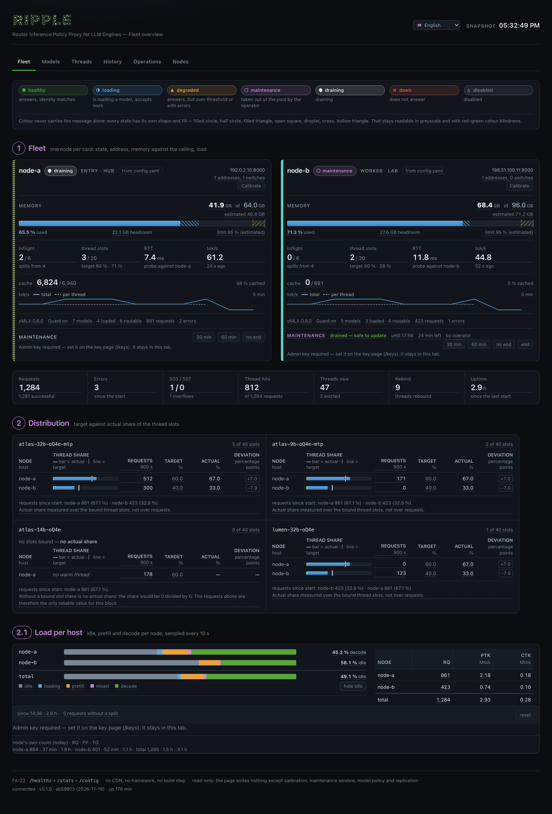

# RIPPLE

**R**outer **I**nference **P**olicy **P**roxy for **L**LM **E**ngines —
thread-based placement with residency protection in front of several **oMLX**
instances. It distributes requests, weighted, over the nodes and delegates only
when that makes sense.



The dashboard as it looks when it runs — six tabs, no installation required:
[`docs/dashboard-mockup.html`](docs/dashboard-mockup.html) is a snapshot of the
built page, generated from a running instance.

```
Client (opencode, Hermes, ...)
   │
   ▼
RIPPLE :8010  — sticky threads, weights 3:2, spillover
   │
   ├──► oMLX alpha :8000   weight 3
   └──► oMLX beta  :8000   weight 2
```

Full specification: [`docs/requirements.md`](docs/requirements.md).
Measured evaluation of the Olla proxy (why this is a custom build):
[`docs/olla-evaluation.md`](docs/olla-evaluation.md).
Measurements — what one node can do and what the fleet did:
[`docs/measurements.md`](docs/measurements.md).
Putting it into operation, including how to switch a client over:
[`docs/commissioning.md`](docs/commissioning.md).
Where the nodes stand, and why a site is a location and not a link:
[`docs/sites.md`](docs/sites.md).
The operator's manual — every panel and every control, with a chapter of its own
for the optimizer: [`docs/manual-en.md`](docs/manual-en.md).
Why a second Mac only helps when the work above RIPPLE is parallel:
[`docs/manual-en.md`](docs/manual-en.md) §9.

State: `ripple init`, `ripple discover` and `ripple doctor` exist, the
distribution builds as `ripple-proxy`, and the suite has 1264 tests
(`python -m pytest --collect-only`, 19.11.2026 — a snapshot, not a target).
Start with [`docs/install.md`](docs/install.md) (English, the primary document)
or [`docs/install-de.md`](docs/install-de.md) (German).

## Why not the oMLX cluster?

The cluster mode (JACCL/TB5) **splits one model** across machines — sensible only
for models that do not fit into a single machine. It does not distribute
requests. This project does the opposite: every model stays whole on one node,
the load is distributed.

## Routing: thread placement, not request distribution

The unit of placement is the **thread** (a conversation). It is bound to a node
on its first request and stays there — every follow-up turn, every tool round.
The 3:2 split arises because **new** threads go to the node that is furthest
below its target share:

```
deficit(node) = target_share(node) × (active_threads + 1) − threads_on_node
```

With 5 active threads that yields exactly 3 on alpha and 2 on beta, with 10
exactly 6 / 4. A thread releases its slot after `affinity.ttl_seconds`
(default 1800) without a request; short single requests (vision, classification)
hold a slot only for the duration of the answer.

Placement decides where a **new** conversation goes. An existing thread can also be
**moved** — when the fleet is faster with it somewhere else — and that decision is
the optimizer's: relative load picks the source, a measured `Δtotal` picks the
destination, and "move nothing" is a possible verdict. It is not a rule of thumb and
not "spread it evenly"; the manual gives it a chapter of its own
([`docs/manual-en.md`](docs/manual-en.md) §4).

Before placement, filters apply — each with a veto, each moving on to the next
candidate instead of aborting:

1. **Model filter** — only nodes that offer the model (`/v1/models`).
2. **Residency** (`prefer_resident`) — prefers nodes that already hold the
   model. Loading a 400 GB model cold costs 60–70 s.
3. **Slots** — `threads_on_node < max_threads`, and `inflight < max_inflight`.
4. **Eviction guard** — the node is refused if loading the model would evict a
   model that a running thread holds (or that is pinned). If no node can take
   the request without evicting, the answer is HTTP 503 naming the conflict —
   never a silent eviction of a running session.

Capacity comes before the deficit rule: no new thread goes to a node with
`inflight >= spill_threshold` while another candidate still has room. If every
candidate is full, the request goes to the node with the largest relative
headroom `(inflight+1)/weight`.

Recognising that a request belongs to a known thread: header `X-Session-Id`,
otherwise a fingerprint over model + first user message (the system prompt is
**excluded** — it carries timestamps), otherwise a prefix similarity measure
that survives a compressed conversation.

## What the weighting cannot do

- Models only one node offers (e.g. a large model that only alpha has) go 100 % there. 3:2 only
  applies to models **both** nodes offer.
- The smaller node has to keep shared models warm, otherwise every spill pays the load
  time. `warmup` in the configuration does that at startup.
- The eviction guard needs `estimated_size` and `final_ceiling` from the
  backend. Without them (adapter without `residency`) the guard switches itself
  **off visibly** — `eviction_guard: false` in `/healthz` and a banner in the
  dashboard. No silent degradation.

## Installation

```bash
git clone <repo-url>
cd ripple
python3 -m venv .venv                  # Python >= 3.9 is enough (3.9.6 tested)
./.venv/bin/python -m pip install .    # `pip install .`, not `-e` — see below
./.venv/bin/ripple init                # port, nodes, oMLX key → config.yaml
./.venv/bin/ripple doctor              # says what is missing, ends in a real request
```

`pip install -e .` needs `pip install -U pip setuptools` first on a bare
`python3 -m venv` (pip 21.2.4 / setuptools 58 on Apple's 3.9.6); `pip install .`
works as it is.

The full walkthrough — the init conversation, `doctor`, switching a client over,
the dashboard, key handling and the failures that actually happen — is
[`docs/install.md`](docs/install.md) — English, the source for translations —
and [`docs/install-de.md`](docs/install-de.md) in German.

## Start

```bash
./.venv/bin/ripple --config config.yaml
# or double-click deploy/start-ripple.command
```

Then point the clients at `http://<host>:8010/v1` instead of `:8000`.

Validate without accepting requests (probes both upstreams, verifies the
`node_id` and prints the routing table):

```bash
./.venv/bin/python -m ripple --config config.yaml --check
```

Check at runtime:

```bash
curl -s localhost:8010/healthz | python3 -m json.tool
curl -s localhost:8010/stats   | python3 -m json.tool
open http://localhost:8010/            # read-only dashboard, reloads every 2 s
```

`/healthz` shows per host: health, offered models, loaded models, `inflight`,
weight, occupied thread slots, target share, RTT and capabilities. `/stats`
shows requests, errors, affinity hits, spillover, fallbacks and measured tok/s.

## Endpoints

| Path | Purpose |
|---|---|
| `POST /v1/chat/completions` | main path, with and without `stream: true` |
| `POST /v1/completions`, `POST /v1/embeddings` | passed through, same routing |
| `GET /v1/models` | merged model list of all healthy hosts |
| `GET /healthz` | fleet, models, threads, capabilities (FA-13) |
| `GET /stats` | counters and the last 200 routing decisions |
| `GET /config` | the effective configuration, secrets reduced to `set`/`none` |
| `GET /` | read-only dashboard, no CDN, no build step |
| `POST /reinit` | re-resolve all host addresses (after a site change) |

Every proxied response carries `X-Ripple-Host` and `X-Ripple-Reason`
(`new_thread`, `thread`, `ephemeral`, `cold_load`, `evict_idle`, `model_pinned`,
`fallback`).

## Configuration

See `config.example.yaml` (commented). Short version:

| Field | Meaning |
|---|---|
| `listen_host` / `listen_port` | address of the balancer (default `0.0.0.0:8010`) |
| `hosts[].name` | stable identity — key for slots, affinity and logs |
| `hosts[].node_id` | expected `GET /api/cluster/node_id`; an address alone is not an identity |
| `hosts[].addresses[]` | probing order, one address is used at a time |
| `hosts[].weight` | target share (3:2) |
| `hosts[].models[]` | allow-list: this host may serve only these models |
| `hosts[].api_key` | key sent upstream (`${VAR}` is expanded) |
| `hosts[].max_inflight` | hard upper bound of concurrent requests |
| `hosts[].max_threads` | thread slots on this host |
| `hosts[].spill_threshold` | from how many concurrent requests the host counts as full |
| `hosts[].hard_threshold` | oMLX `memory.hard_threshold` — the admission target |
| `affinity.ttl_seconds` | how long a thread keeps its slot while idle |
| `affinity.header` | header carrying the session id (default `X-Session-Id`) |
| `placement.binding_strategy` | `deficit` (default), `consistent_hash`, `least_threads` |
| `discovery.interval_seconds` | how often models/residency are re-read |
| `warmup` | models to preload at startup |

## Tests

```bash
./.venv/bin/python -m pytest -q
```

The tests start stub upstreams (no real model, no oMLX needed) and check the
distribution, affinity, prefix similarity after compression, spillover, the
model filter, streaming, retry before the first byte, the eviction guard, the
address fallback and the capability reporting.

## As a service (launchd)

```bash
cp deploy/ai.ripple.plist ~/Library/LaunchAgents/
launchctl bootstrap gui/$(id -u) ~/Library/LaunchAgents/ai.ripple.plist
```

Adjust the paths in the plist (project directory, python, config). Details in
`deploy/README.md`.

## Emergency operation

If the balancer itself is down, the node is still reachable directly on `:8000`.
That is the documented fallback (RB-1) — one line in the client configuration.

## Licence

MIT — see `LICENSE`.
