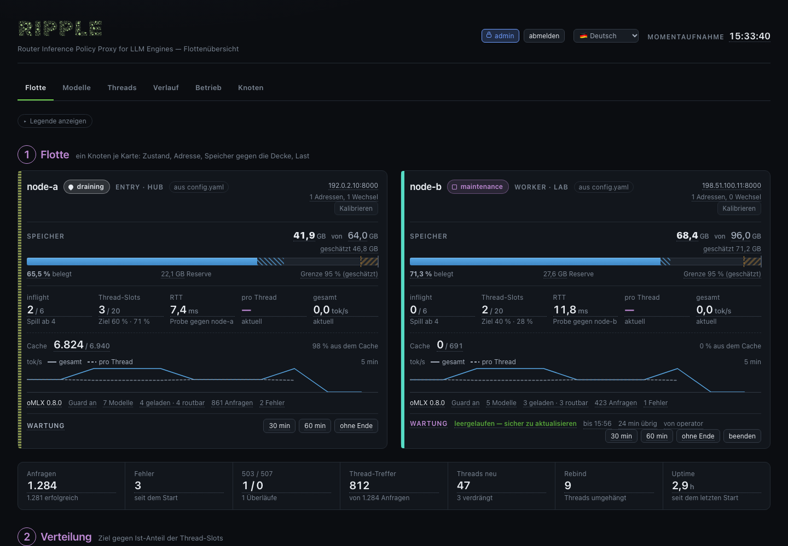
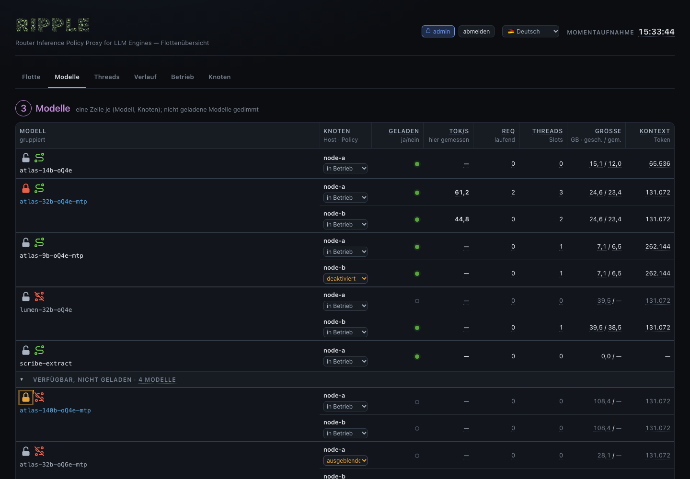

# RIPPLE installieren

[English](install.md) · Deutsch

RIPPLE ist ein Platzierungs-Proxy vor einem oder mehreren oMLX-Knoten. Er spricht die OpenAI-kompatible API auf `/v1` und entscheidet, welcher Knoten antwortet. Die Einheit der Platzierung ist der Thread, nicht die Anfrage: Eine Konversation wird bei ihrer ersten Anfrage an einen Knoten gebunden und bleibt dort für ihre Folgerunden, neue Konversationen werden nach Gewicht über die Knoten verteilt, und eine Anfrage, die einen Knoten zwingen würde, ein Modell zu verdrängen, das eine andere Konversation gerade nutzt, wird mit einem benannten Grund abgelehnt statt bedient.

Drei Befehle erledigen die Arbeit:

```
ripple init      # einmalig: Port, Knoten, Standort, Schlüssel — schreibt die Konfiguration
ripple doctor    # sagt, was fehlt, und schickt eine echte Anfrage
ripple           # startet den Proxy
```

---

## 1. Was RIPPLE ist und was du brauchst

RIPPLE führt keine Modelle aus. Es braucht mindestens eine oMLX-Instanz, die sie bereits ausliefert, und es muss die Modellliste dieser Instanz lesen können — sonst hat es nichts zu routen.

| | |
|---|---|
| Python | **>= 3.9**. 3.9 und 3.13 gehen beide. |
| oMLX | eine oder mehrere laufende Instanzen, über HTTP erreichbar (oMLX hört standardmäßig auf `:8000`) |
| oMLX-API-Schlüssel | nur wenn dein Knoten Modelle nur mit Schlüssel auflistet — siehe unten |
| Netzwerk | einmalig, für die Installation (der Build holt `setuptools`) |

Kein weiteres Werkzeug ist nötig: kein Homebrew, kein `uv`, kein `pipx`, kein Compiler. Ein `python3 -m venv` und `pip` reichen. `uv` funktioniert auch, und Abschnitt 2 zeigt es.

**Der Schlüssel ist wichtiger, als er aussieht.** Eine oMLX-Instanz beantwortet ihre Modellliste mit `401`, wenn kein Schlüssel mitgeschickt wird:

```bash
$ curl -s -o /dev/null -w '%{http_code}\n' http://127.0.0.1:8000/v1/models
401
$ curl -s http://127.0.0.1:8000/v1/models
{"error":{"message":"API key required","type":"authentication_error","param":null,"code":null}}
```

Ohne Schlüssel ist ein Knoten für RIPPLE nicht lesbar: Es kennt keine Modelle und kann nichts routen. Die Installation funktioniert trotzdem — der Proxy startet, das Dashboard zeigt den Knoten, `ripple doctor` meldet die Einschränkung als Warnung statt als Fehler —, aber es fließt kein Verkehr. Der Schlüssel steht in oMLX selbst: Admin-Panel dieser Instanz (`http://<host>:8000/admin`) → **Settings** → **API key**. Abgelegt ist er in `~/.omlx/settings.json` unter `auth.api_key`. oMLX schreibt **keine** Textkopie davon — liegt auf einer Maschine eine `~/.omlx/api_key.txt`, hat sie jemand angelegt, damit andere Werkzeuge sie lesen können; `ripple init` bietet sie an, wenn sie da ist, und akzeptiert auch `$OMLX_API_KEY`. `ripple init` schreibt den Schlüssel nicht in die `config.yaml`, sondern in `~/.ripple/secrets.yaml` (Modus 0600) und hinterlässt dort nur einen Verweis (`api_key_file: ~/.ripple/secrets.yaml#omlx.fleet`) — die Konfiguration ist die Datei, die man in ein Forum kopiert. `ripple doctor` meldet `OK secrets`, wenn eine Datei keinen Schlüssel enthält. Bei mehr als einem Knoten wird der Schlüssel pro Knoten gefragt: die erste Antwort gilt für die übrigen als Vorgabe, und ein Knoten, der den Schlüssel ablehnt, wird einmal nach seinem eigenen gefragt — der Unterschied landet als `hosts.<name>.api_key` in der Datei, weil jede Maschine ihren eigenen Schlüssel hat.

---

## 2. Installation

```bash
git clone <repo-url>
cd ripple
./install.sh
```

`install.sh` sucht Python, legt `.venv` an, installiert RIPPLE und bietet am Ende `ripple init` an. Im Finder geht auch Doppelklick auf `Install.command` — macOS öffnet sie im Terminal. Dieselben Schritte von Hand, wenn dir das lieber ist:

```bash
python3 -m venv .venv
./.venv/bin/python -m pip install .

./.venv/bin/ripple --version
# RIPPLE 0.2.3
```

### Kein `python3`? Das ist das Einzige, was die Installation nicht selbst kann

macOS liefert seit 12.3 kein Python mehr mit. RIPPLEs eigene Abhängigkeiten (fastapi, uvicorn, httpx, PyYAML) holt pip; Python nicht. `./install.sh` sagt das und druckt die zwei Zeilen, die es lösen — eine davon in Terminal kopieren:

```bash
xcode-select --install      # Apples Command Line Tools, bringen python3 mit
brew install python@3.13    # oder Homebrew, falls vorhanden
```

Sonst fehlt nichts: kein Compiler, kein `uv`, kein `pipx`.

Das Distributionspaket heißt `ripple-proxy` (der PyPI-Name `ripple` gehört zu fremden Projekten); das Import-Paket und das Konsolenskript heißen beide `ripple`. Das Dashboard, sein Stylesheet und alle 16 Sprachkataloge reisen im Wheel mit.

### `pip install .` funktioniert in einem alten venv, `pip install -e .` nicht

Ein nacktes `python3 -m venv` auf macOS 3.9.6 gibt dir pip 21.2.4 und setuptools 58.0.4. `pip install .` funktioniert dort, weil der Build in einer isolierten Umgebung läuft, die ein aktuelles `setuptools` holt. `pip install -e .` nicht:

```
ERROR: File "setup.py" or "setup.cfg" not found. Directory cannot be installed in editable mode: /Users/you/ripple
(A "pyproject.toml" file was found, but editable mode currently requires a setuptools-based build.)
```

Wenn du eine editierbare Installation willst — du änderst den Code —, aktualisiere zuerst die Build-Werkzeuge:

```bash
./.venv/bin/python -m pip install -U pip setuptools
./.venv/bin/python -m pip install -e .
```

### Mit uv

```bash
uv venv .venv
uv pip install --python .venv/bin/python .
```

---

## 3. Erster Lauf: `ripple init`

```bash
./.venv/bin/ripple init
```

`init` fragt sechs Dinge und schreibt zwei Dateien. Ein Lauf gegen einen einzelnen lokalen Knoten sieht so aus; alles in Klammern ist der Standard, und eine Zeile ohne Antwort hat ihn übernommen. (Die Konfigurationsprüfung am Ende ist hier auf ihren Knoten-Block gekürzt.)

```
RIPPLE init — first-run configuration
config:   /Users/you/ripple/config.yaml
key store: /Users/you/.ripple/keys.yaml

Port [8010]:
port: 8010
discovered 1 node(s):
  local  http://127.0.0.1:8000  23 model(s)
Use these nodes? [Y/n]:
node 1/1 (http://127.0.0.1:8000) name [local]: alpha
node 1/1 (http://127.0.0.1:8000) weight [1]:
node 1/1 (http://127.0.0.1:8000) models (comma separated; empty = the chat-capable ones, `all` = every model the node offers):
Site name (room, building or city; empty = local) [local]:
Site networks (CIDR, comma separated) [192.0.2.0/24]:
site local: local — 192.0.2.0/24
  loopback: alpha — this machine, no site: written (loopback is in no site's networks; `ripple doctor` reports SKIP)
Use the oMLX key from $OMLX_API_KEY? [Y/n]:
oMLX key: read from $OMLX_API_KEY
node alpha: allow-list = 21 chat-capable model(s); left out 2 that are not chat models: MarkItDown (markitdown), Qwen3-Embedding-4B-4bit-DWQ (embedding) — name them (or answer `all`) to route them
RIPPLE admin key (empty = generate a 32-hex one):

wrote /Users/you/ripple/config.yaml (mode 0600)
RIPPLE admin key — shown once, store it now:
  4f1c8a2b7d3e90516caf42b8de710593
  (also in config.yaml at auth.admin_key; it opens /keys and /admin/*)

wrote /Users/you/.ripple/keys.yaml (mode 0600)

client key "first-client" — shown once, store it now:
  rip-EXAMPLE00000000000000000000000

  use it as:  Authorization: Bearer <the key above>
  later only the masked form is shown; rotate it on the /keys page with the admin key.

— configuration check —
[alpha] role=worker site=- weight=1.0 target=100%
  address:  http://127.0.0.1:8000   status: healthy
  node_id:  4b7d1e0a-9c62-4f38-8a15-2e5c9d7f3b61
  version:  0.8.0rc1   rtt: 0.8 ms
  memory:   219902325555/274877906944 bytes (80.0%), guard=on
  models:   23 offered, 3 loaded

— one real request through the new configuration —
test request: 200 — model qwen3-coder-30b — {"id":"chatcmpl-9f3c1a2b","object":"chat.completion",…}

RIPPLE is configured. Start it with:  ripple --config ~/.ripple/config.yaml
```

### Was die Fragen bedeuten

**Port.** Wo der Proxy lauscht (`listen_host: 0.0.0.0`, also auf jeder Schnittstelle). Ist der Port belegt, nennt `init` den Prozess, der ihn hält, und bietet den nächsten freien an:

```
Port [8010]:
port 8010 is already in use by PID 48911 (python3.13)
Use port 8011 instead? [Y/n]:
port: 8011
```

Nimm den Vorschlag an, oder antworte `n` und gib einen Port ein. So oder so geht der Rest dieser Anleitung von `8010` aus — ersetze ihn überall durch deinen, auch in der Basis-URL des Clients und in `ripple doctor --url`. Stoppe nicht den Prozess, der den Port hält, nur um die Nummer zu behalten.

**Knoten.** Ohne `--host` prüft `init` genau eine Adresse, `http://127.0.0.1:8000`, und sonst nichts. Ein Netzwerk-Scan passiert nie von selbst; das ist ein eigener, ausdrücklicher Befehl:

```bash
./.venv/bin/ripple discover --scan 192.168.1.0/24
```

`discover` gibt eine Zeile pro Knoten aus, mit Adresse, `node_id`, Modellanzahl, Latenz und ob Admin-Rechte bestehen; `--json` liefert dasselbe als Daten, `--address` prüft einen bestimmten Knoten statt zu scannen. Die Identität kommt aus `GET /api/cluster/node_id`, nie aus der Adresse — ein Knoten, der umgezogen ist, wird wieder gefunden. Eine Adresse, die nichts beantwortet, wird trotzdem ein Knoten in der Konfiguration: Ein Knoten, der gerade aus ist, ist genau der, den du heute konfiguriert haben willst, also wird er aufgenommen, wenn er zurückkommt.

**Name, Gewicht, Modelle.** Der Name ist der stabile Schlüssel für Thread-Slots, Affinität und jede Logzeile; wähle etwas, das du in einem Log wiedererkennst. Das Gewicht ist der Zielanteil neuer Threads — `3` und `2` bedeuten 60 % / 40 %. Die Modell-Antwort ist eine Allow-List: leer nimmt den Standard, und der sind die **chat-fähigen** Modelle des Knotens — alles, dessen `model_type` ein Chat-Typ ist (`llm`, `vlm`, …). oMLX bietet daneben Utility-Engines an (`markitdown` wandelt Dokumente um, `embedding` ist ein Embedding-Modell); sie sind legitim, aber sie sind keine Threads, die man balanciert — sie bleiben draußen, solange du sie nicht nennst. `init` sagt in einer Zeile, was es erlaubt hat und welche Modelle es mit ihrem Typ ausgelassen hat: die leere Antwort ist eine Entscheidung, die man lesen kann, kein Standardwert. Antworte `all`, um `models` bewusst leer zu lassen: dann ist jedes Modell des Knotens routbar, auch die Utility-Engines, und `init` sagt, wie viele es sind. Eine selbst getippte Liste wird genau so geschrieben, wie sie getippt wurde — und sie friert die heutige Flotte ein: ein Modell, das du nächsten Monat in oMLX hinzufügst, bliebe in RIPPLE unsichtbar, ohne dass irgendetwas sagt, warum. Deshalb gibt es den chat-fähigen Standard statt der vollen Liste von heute. Der Typ ist die Erklärung des Knotens selbst, und sie ist nicht immer das, was ein Betreiber ein Chat-Modell nennen würde: ein Draft-Modell für spekulatives Dekodieren (`…-drafter`) wird als `llm` gemeldet und wäre wie jedes andere routbar. Trägt dein Knoten eines, nimm es aus der Liste oder verberge es mit der Modell-Policy (Handbuch §6.2).

**Der Standort.** Nach den Knoten fragt `init`, wo diese Maschine steht: einen Namen — den Raum, das Gebäude, die Stadt — und die Netze, die dazugehören, als CIDR. Die Reihenfolge ist nicht kosmetisch: Diese Netze werden gegen die Knotenadressen geprüft, also müssen die Knoten vorher bekannt sein. Der Vorschlag für die Netze wird aus der Schnittstelle abgeleitet, die die Default-Route trägt (`ifconfig` auf macOS, `ip -o -4 addr` auf Linux); Loopback (`127.0.0.0/8`) und Link-Local (`169.254.0.0/16`) werden verworfen, denn eine Schnittstelle, die nur eine selbst vergebene Adresse trägt, ist kein Standort. Lässt sich nichts ableiten, fragt `init`, statt `192.168.0.0/24` zu erfinden.

**Die Netze sind kein Suchbereich** — `init` prüft nur die Adressen, die es bekommen hat, und die Netze sind ein Etikett dafür, wo diese Maschine steht. Wer `192.0.2.0/24` einträgt, liest das als „schau dort nach", deshalb bietet `init` direkt nach den Netzen den Durchlauf an:

```
Scan 192.0.2.0/24 for further oMLX nodes? (a sweep: one request per address, port 8000) [y/N]:
```

Der Standard ist **nein**: ein Sweep ist Verkehr in einem fremden Netz — genau deshalb hält auch `ripple discover` ihn hinter einem ausdrücklichen `--scan`. Wer `y` antwortet, bekommt für jeden gefundenen Knoten dieselben drei Fragen wie für den Knoten auf Loopback — Name, Gewicht, Modelle —, und danach wird er genauso behandelt (Key-Frage pro Knoten, Allow-List, `doctor`). Einen Knoten, den die Flotte schon hat, überspringt der Durchlauf über die `node_id`: dasselbe oMLX antwortet auf jeder Adresse, auf der es lauscht, auch auf der LAN-Adresse dieser Maschine.

Enter nimmt den Standard `local` und das abgeleitete Netz. Der Standort wird als ein Block geschrieben — die `id` kommt aus dem Namen, klein geschrieben, mit Bindestrichen —, und `site: <id>` steht **nur** an einem Knoten, dessen Adresse wirklich in einem der Netze liegt. Ein Knoten in einem anderen Netz bleibt ohne Standort, statt eine Behauptung zu erben, die `doctor` dann widerlegen müsste: Ein einzelner lokaler Knoten über Loopback behält also `site=-`, während der Block existiert — und `init` sagt das in einer Zeile, statt es dich merken zu lassen. Das ist die ehrliche Antwort und keine Lücke: `127.0.0.1` heißt *diese Maschine*, ein Standort benennt *Netze*, und Loopback ist in keinem davon — es gibt also nichts zu vergleichen, und `ripple doctor` meldet `SKIP` mit Loopback als Begründung (siehe §4). Sobald eine zweite Maschine konfiguriert ist, liegt deren Adresse in einem Netz, und ihr `site:` ist eine Behauptung, die tatsächlich geprüft wird.

Ein leerer Name bedeutet **kein Standort**: kein `sites:`-Block, kein `site:` an einem Knoten, und es gibt nichts zu warnen und nichts zu prüfen. Der Standard der Frage ist `local`, ein leerer Name ist also eine bewusste Antwort (`--site-name` mit einem Wert, der zu nichts wird) oder eine von Hand geschriebene Konfiguration — Enter ist es nicht.

Mit erfundenen Werten — Dokumentationsnetze aus RFC 5737 — sehen die beiden Fragen so aus:

```
Site name (room, building or city; empty = local) [local]: Werkstatt
Site networks (CIDR, comma separated) [192.0.2.0/24, 198.51.100.0/24]:
site werkstatt: Werkstatt — 192.0.2.0/24, 198.51.100.0/24
  nodes inside it: alpha
```

Was das schreibt — der `sites:`-Block und der Host-Eintrag:

```yaml
sites:
- id: werkstatt
  name: Werkstatt
  networks:
  - 192.0.2.0/24
  - 198.51.100.0/24
hosts:
- name: alpha
  addresses:
  - http://192.0.2.10:8000
  weight: 1.0
  site: werkstatt
```

Ein Standort ohne `networks` wird angenommen statt abgelehnt: Er ist ein Name, den niemand prüfen kann, und `ripple doctor` sagt genau das, statt es vorzutäuschen. Zwei Standorte mit überlappenden Netzen sind ebenfalls eine Warnung — der erste Standort in der Datei gewinnt.

**Der oMLX-Schlüssel.** `init` fragt ihn pro Knoten, nimmt ihn aus `$OMLX_API_KEY`, aus `~/.omlx/api_key.txt` oder aus deiner Eingabe (ohne Echo); ab dem zweiten Knoten lautet die Frage `same oMLX key as node 1?`, und ein abgelehnter Schlüssel wird einmal pro Knoten nachgefragt. Eine leere Antwort ist gültig und bedeutet Nur-Lesen: Die Konfiguration wird ohne Schlüssel geschrieben, und der Knoten antwortet auf seine Modellliste mit `401`. Der Schlüssel wird nie ausgegeben und nie geloggt.

**Die Prefill-Rate (`pp_tps`).** `init` schreibt sie nicht, und zum Starten braucht sie niemand: `hosts[].pp_tps` ist die gemessene Kalt-Prefill-Rate eines Knotens in Token pro Sekunde, und sie hat genau eine Aufgabe — einen Umzug zu bepreisen. Wenn RIPPLE einen gebundenen Thread auf einen anderen Knoten umzieht, muss dessen ganzer Prompt dort neu geprefillt werden, was `prompt_tokens / pp_tps` Sekunden kostet; `placement.rebind` wiegt diese Kosten gegen den Decode-Gewinn ab, bevor es etwas umzieht, und ein Knoten ohne Rate hat kein Kostenmodell und ist nie ein Ziel. `placement.rebind.default_pp_tps: 0` heißt *nicht gemessen*, nicht *unendlich schnell*: 0 bepreist nichts, damit wird jeder Knoten ohne eigenes `pp_tps` übersprungen, und Rebinding ist an, kann aber nie feuern — genau davor warnt `ripple doctor` (siehe §4). Nimm die Zahl aus deiner eigenen Messung (`docs/measurements.md` hat das Verfahren und die Referenzwerte) und schreib sie in den Host-Eintrag.

### Was `init` schreibt

| Datei | Inhalt |
|---|---|
| `~/.ripple/config.yaml` (oder `--config PATH`) | die Konfiguration, Modus `0600`; sie nennt die Schlüssel, sie enthält sie nicht |
| `~/.ripple/keys.yaml` (oder `<home-dir>/.ripple/keys.yaml`) | Client-Schlüssel, Modus `0600` |

Der Admin-Schlüssel wird abgefragt: entweder einen eintippen (er wird genau so verwendet und nie zurückgezeigt — nur seine Länge wird gemeldet, denn ein kurzer Schlüssel ist eine legitime Wahl) oder Enter drücken, dann generiert `init` 32 Hex-Zeichen und gibt sie einmal aus, in derselben Form wie den Client-Schlüssel. So oder so landet der Schlüssel in `auth.admin_key`, und der Betreiber beendet die Installation mit ihm in der Hand. Der Client-Schlüssel wird genau einmal ausgegeben — kopiere ihn jetzt; danach wird nur die maskierte Form gezeigt. Keiner der beiden Schlüssel erreicht je das Logfile oder die Routing-Tabelle. Zum Schluss lädt `init` die gerade geschriebene Konfiguration, gibt die Routing-Tabelle aus und schickt eine echte Completion durch den Proxy, denn eine Konfiguration, die validiert, ist nicht dasselbe wie eine, die antwortet. Eine vorhandene `config.yaml` oder ein vorhandener Schlüsselspeicher wird nie überschrieben: `init` verweigert, nennt den Pfad und verweist auf `--force`.

Der oMLX-Schlüssel wird bewusst unter **beiden** Namen geschrieben — eine Frage, zwei Felder:

```yaml
defaults:
  api_key: …            # RIPPLE → oMLX: der Client-Schlüssel, der durchgereicht wird
replication:
  admin_key: …          # derselbe oMLX-Schlüssel: Admin-Aufrufe und die Zustands-Messung
  # `enabled` bleibt false — der Schlüssel allein schaltet die Replikation nicht ein
```

`defaults.api_key` ist das, was RIPPLE für Completions an die Knoten schickt. `replication.admin_key` ist derselbe Schlüssel unter dem Namen, den die Zustands-Messung pro Host (`GET /admin/api/activity`, die Kurven auf der Fleet-Karte) und die Admin-Aufrufe der Replikation lesen. Eine Konfiguration mit nur dem ersten Feld ist der Grund, warum eine frische Installation früher gleichzeitig ein grünes `ripple doctor` und eine leere Fleet-Karten-Historie zeigte; `init` schreibt beide, damit die beiden Aussagen übereinstimmen. Eine von Hand gebaute Konfiguration braucht ebenfalls beide Zeilen — `replication.enabled` bleibt auf seinem Standard (`false`), bis du die Replikation bewusst einschaltest.

Flags (`ripple init --help`):

| Flag | Wirkung |
|---|---|
| `--yes` | jeden Standard nehmen, statt zu fragen — derselbe Codepfad, ein skriptgesteuerter Lauf erzeugt also das, was ein interaktiver erzeugt |
| `--force` | eine vorhandene `config.yaml` / einen vorhandenen Schlüsselspeicher überschreiben |
| `--port N` | Listen-Port (Standard 8010; ein belegter Port rückt auf den nächsten freien) |
| `--host URL` | oMLX-Adresse, wiederholbar |
| `--name NAME` | Knotenname; nur bei genau einem Knoten |
| `--config PATH` | wohin `config.yaml` geschrieben wird (Standard `~/.ripple/config.yaml`) |
| `--home-dir PATH` | Home-Verzeichnis statt `$HOME`; der Schlüsselspeicher geht nach `<path>/.ripple/keys.yaml` |
| `--omlx-key KEY` | der oMLX-Schlüssel auf der Kommandozeile statt aus der Umgebung |
| `--no-check` | die abschließende Konfigurationsprüfung und die Testanfrage überspringen |

Exit-Codes: `0` konfiguriert und geprüft, `1` verweigert oder abgebrochen (nichts geschrieben), `2` Dateien geschrieben, aber die Prüfung ist nicht durchgelaufen.

---

## 4. Die Installation prüfen: `ripple doctor`

```bash
./.venv/bin/ripple doctor --config config.yaml
```

Standardwerte: `~/.ripple/config.yaml` (oder `./config.yaml`, wenn nur das existiert), `--url http://127.0.0.1:8010`, `--timeout 10` Sekunden pro Netzwerkprüfung. Bevor der Proxy läuft, werden `dashboard` und `completion` übersprungen — und `site` ebenfalls, weil der einzige Knoten dieser Installation über Loopback erreicht wird und es keine Netzadresse gibt, die man gegen die Netze des Standorts halten könnte:

```
RIPPLE 0.1.0 — doctor
config: /Users/you/ripple/config.yaml   proxy: http://127.0.0.1:8010
────────────────────────────────────────────────────────────────────────
OK   python     3.13.9 (requires >= 3.9)
OK   config     /Users/you/ripple/config.yaml — 1 host(s), no warnings
WARN rebind     rebind is on, but no destination has a prefill rate — it cannot fire: 'hosts[].pp_tps' is unset on alpha and 'placement.rebind.default_pp_tps' is 0 — 0 means not measured, not infinitely fast; set 'hosts[].pp_tps' on a node to give a move a price
OK   port       port 8010 on 127.0.0.1 is free — RIPPLE can bind it
OK   node       alpha: http://127.0.0.1:8000 answered in 9.1 ms
OK   identity   alpha: node_id 4b7d1e0a-9c62-4f38-8a15-2e5c9d7f3b61 matches the config
OK   admin      alpha: admin rights (HTTP 200 on /admin/api/activity)
SKIP site       alpha: reached over loopback (http://127.0.0.1:8000) — this machine; a site names networks and loopback is in none, so nothing was compared
OK   keys       /Users/you/.ripple/keys.yaml — 1 key(s), mode 0600, admin key set
SKIP dashboard  no RIPPLE on http://127.0.0.1:8010 — skipped
SKIP completion no RIPPLE on http://127.0.0.1:8010 — skipped
────────────────────────────────────────────────────────────────────────
11 checks: 7 OK, 1 WARN, 0 FAIL, 3 skipped
Result: OK — warnings only, nothing is broken.
```

Das eine `WARN` ist `rebind`, und es steht dort, weil `init` es nicht wissen kann: Noch hat kein Knoten ein `pp_tps`, und `placement.rebind.default_pp_tps` ist `0` — damit kann in dieser Flotte nichts einen Umzug bepreisen, und Rebinding (standardmäßig an) kann nie feuern. Es ist eine Warnung und kein Fehler: Jede Anfrage wird geroutet. Schreib die gemessene Kalt-Prefill-Rate des Knotens in seinen Host-Eintrag (`pp_tps: 3680`, siehe §3), und die Zeile wird `OK`; lässt du sie weg, passiert die Verteilung zwischen den Knoten einfach nicht — genau das sagt die Zeile.

Gegen einen laufenden Proxy laufen die letzten beiden, statt übersprungen zu werden, und die Port-Zeile sagt es:

```
OK   port       port 8010 is already serving RIPPLE 0.1.0
OK   dashboard  http://127.0.0.1:8010: /healthz 200, dashboard page 7.3 kB, 1/1 node(s) healthy
OK   completion qwen3-coder-30b answered in 3661 ms via alpha
11 checks: 9 OK, 1 WARN, 0 FAIL, 1 skipped
```

Die eine übersprungene Prüfung ist `site`: Der Knoten wird über Loopback erreicht, ist also *diese* Maschine, und es gibt keine Netzadresse, die man gegen die Netze des Standorts halten könnte. Eine Einzelmaschinen-Installation hat dort nichts zu prüfen, und die Zeile sagt genau das, statt dich raten zu lassen — dasselbe Ergebnis, das `ripple init` beim Schreiben des Blocks angekündigt hat. Mit einem Knoten, der über ein Netz erreicht wird, und einem `site:` daran, ist es eine Zeile pro Knoten, `OK` oder `WARN` — siehe unten.

Was geprüft wird, in dieser Reihenfolge:

| Prüfung | Frage |
|---|---|
| `python` | Interpreter-Version gegen die 3.9-Untergrenze |
| `config` | die Datei lädt — über `load_config`, denselben Aufruf, den `ripple --check` macht, sodass doctor keine Datei absegnen kann, die der Proxy ablehnen würde |
| `rebind` | ob `placement.rebind` einen Umzug überhaupt bepreisen kann: `WARN`, wenn Rebinding an ist und kein aktivierter Knoten ein `pp_tps` hat (bei `default_pp_tps: 0`), weil dann kein Ziel wählbar ist und die Funktion nie feuern kann; `OK` mit den Knoten, die bepreist werden können; `SKIP`, wenn Rebinding ausgeschaltet ist |
| `port` | frei, schon RIPPLE bedienend oder von etwas anderem gehalten (Letzteres ist ein `FAIL` und nennt den Prozess) |
| `node` | pro Knoten: welche Adresse geantwortet hat und wie schnell; `WARN`, wenn er antwortet, sich aber selbst als ungesund meldet |
| `identity` | pro Knoten: die gemeldete `node_id` gegen die aus der Konfiguration; `WARN`, wenn die Konfiguration keine hat oder der Knoten nicht lesbar ist, `FAIL` bei Abweichung |
| `admin` | pro Knoten: `GET /admin/api/activity` — `200` sind Admin-Rechte, `401`/`403` ist Nur-Lesen und ein `WARN`, kein Fehler |
| `site` | pro Knoten: der deklarierte Standort gegen die Adresse, die tatsächlich geantwortet hat — `OK` bestätigt, `WARN` widersprochen (beide Standorte werden genannt) oder in keinem seiner Netze, `SKIP`, wenn kein Standort deklariert ist, der Knoten nicht erreichbar ist oder er über Loopback erreicht wird (die Zeile sagt, welcher Fall) |
| `keys` | der Schlüsselspeicher existiert, parst, hat Modus `0600`, und ein Admin-Schlüssel ist gesetzt |
| `dashboard` | `/healthz` liefert RIPPLEs Payload und `/` liefert die Dashboard-Seite |
| `completion` | eine echte Completion durch den Proxy: `/v1/models`, dann eine Chat-Anfrage |

`node`, `identity`, `admin` und `site` erzeugen eine Zeile pro Knoten, die Gesamtzahl wächst also mit der Flotte — vergleiche sie nie mit einer festen Zahl. Ohne `sites:`-Block und ohne `site:` an einem Host ist `site` eine einzige `SKIP`-Zeile für den ganzen Bericht.

Die `site`-Prüfung ist die, die eine Behauptung gegen eine Messung hält. Die Behauptung ist `hosts[].site`; die Messung ist die Adresse, über die der Knoten tatsächlich erreicht wurde — die, die der Proxy benutzen würde, nicht unbedingt der erste Eintrag in `addresses`. Liegt diese Adresse in den Netzen des deklarierten Standorts, ist die Zeile `OK`. Liegt sie in den Netzen eines *anderen* Standorts, ist sie ein `WARN`, das beide Standorte nennt, und endet mit `the node is not where the configuration says`. Liegt sie in keinem der Netze des deklarierten Standorts, ist sie ebenfalls ein `WARN`: Die Behauptung ist nicht widerlegt, nur unbestätigt, und die übliche Ursache ist ein vergessenes Netz. Ein Standort ohne `networks` lässt sich gar nicht prüfen — das ist Absicht, und `doctor` berichtet es, statt zu raten. Ein Knoten, der über Loopback erreicht wird, ist der eine Fall ganz ohne Vergleich: `127.0.0.1` ist diese Maschine, ein Standort, der das enthielte, enthielte das Loopback jeder Maschine — die Zeile ist deshalb ein `SKIP`, das Loopback nennt, und ein `site:` an so einem Knoten bleibt unbestätigt, statt als widerlegt gemeldet zu werden.

`OK` heißt geprüft und in Ordnung. `WARN` heißt funktioniert mit Einschränkung — ein Knoten ohne Admin-Rechte ist der Normalfall für jeden, der oMLX' eigenen Schlüssel nicht hat, und das darf nicht als kaputte Installation gelesen werden; **ein `WARN` ändert den Exit-Code nicht**. `FAIL` ist Exit-Code 1. `SKIP` heißt, die Prüfung konnte nicht laufen, meist weil noch kein Proxy lauschte.

Die letzte Prüfung entscheidet, ob die Installation nutzbar ist: Sie schickt eine Completion durch den Proxy, ein grüner Bericht mit rotem `completion` heißt also trotzdem, dass nichts funktioniert.

`--json` gibt denselben Bericht als Daten aus — `version`, `config`, `url`, `checks`, eine `summary` mit `checks`/`ok`/`warn`/`fail`/`skipped` und `exit_code`.

---

## 5. Starten

```bash
./.venv/bin/ripple --config config.yaml
```

Es loggt nach stderr und in die rotierende Datei, die `log_file` nennt (`~/Library/Logs/ripple.log` in `config.example.yaml`, 10 MB × 5 Dateien). Weitere Flags: `--host` und `--port` überschreiben `listen_host`/`listen_port`, `--log-level` überschreibt `log_level`, `--reinit` löst vor dem Start jede Knotenadresse neu auf.

Um die Konfiguration und die Knoten zu prüfen, ohne eine einzige Anfrage anzunehmen:

```bash
./.venv/bin/ripple --config config.yaml --check
```

`--check` baut die Flotte auf, bindet keinen Port, gibt den Knoten-Block und die Routing-Tabelle aus und endet mit `0`, wenn mindestens ein Knoten gesund ist, mit `2`, wenn keiner es ist.

### Als Dienst (launchd, macOS)

```bash
deploy/install-launchd.command
```

Das Skript gibt Port 8010 frei, rendert `deploy/ai.ripple.plist` (eine Vorlage mit den Platzhaltern `__REPO__` und `__HOME__`) nach `~/Library/LaunchAgents/`, schreibt den oMLX-Schlüssel aus `~/.omlx/api_key.txt` hinein, setzt die Datei auf `0600`, lädt den Agenten und prüft `/healthz`. `--dry-run` gibt aus, was es tun würde, und ändert nichts; es scheitert laut, wenn die Schlüsseldatei nicht lesbar ist, denn ohne sie kann der Agent nicht starten.

```bash
launchctl print gui/$(id -u)/ai.ripple | head -20
```

Der Agent startet bei der Anmeldung und startet nach einem Absturz neu, aber nicht nach einem sauberen Beenden. Details, die manuelle Reihenfolge und wie du ihn entlädst: [`deploy/README.md`](../deploy/README.md).

---

## 6. Einen Client darauf richten

Der Client spricht jetzt mit `http://<host>:8010/v1` statt `:8000/v1`, mit einem **Client-Schlüssel** aus `ripple init` (nicht dem Admin-Schlüssel):

```bash
curl -s http://127.0.0.1:8010/v1/chat/completions \
  -H "Content-Type: application/json" \
  -H "Authorization: Bearer $RIPPLE_CLIENT_KEY" \
  -H "X-Session-Id: my-session" \
  -d '{"model":"qwen3-coder-30b","messages":[{"role":"user","content":"Hello"}],"max_tokens":128}'
```

Alles, was die OpenAI-API spricht, funktioniert: Setze seine Basis-URL auf `http://<host>:8010/v1` und seinen Schlüssel auf einen Client-Schlüssel. Clients, die `OPENAI_BASE_URL` lesen, brauchen nichts weiter.

Jede Antwort trägt `x-ripple-host` und `x-ripple-reason`:

```
x-ripple-host: alpha
x-ripple-reason: resident
```

Der Host ist der Knoten, der geantwortet hat. Der Grund ist ein kurzes Token aus einem festen Vokabular — `resident` (das Modell war dort schon geladen), `cold_load` (es muss geladen werden), `new_thread`, `thread` (eine bekannte Konversation bleibt, wo sie ist), `fallback` (ihr Knoten war weg, der Thread ist umgezogen), `model_pinned` (nur ein Knoten bietet dieses Modell), `degraded_host` (von einem Knoten bedient, der eine Probe verpasst hat, statt zu scheitern). Wenn ein Thread einen Slot hält, nennt `x-ripple-thread` ihn.

**`X-Session-Id` ist optional und es lohnt sich, sie zu senden.** Die Platzierungseinheit ist der Thread, nicht die Anfrage: eine ID pro Konversation heißt, RIPPLE muss nie raten, und ein Agent, der seine eigene ID setzt, wird nie auf den falschen Knoten verschoben. Ohne den Header erkennt RIPPLE den Thread an einem Fingerabdruck aus Modell plus erster Nutzernachricht — der System-Prompt ist ausgenommen, weil er Zeitstempel trägt — und dann an der Präfix-Ähnlichkeit, die eine komprimierte Konversation übersteht.

**Notfallpfad.** Wenn der Proxy selbst aus ist, bedient der Knoten weiter auf `:8000`. Richte den Client auf `http://<host>:8000/v1` — eine Zeile —, und RIPPLE hält keinen Zustand, der vor der Rückkehr wiederhergestellt werden müsste.

---

## 7. Das Dashboard

`http://<host>:8010/` — eine Seite, kein CDN, kein Build-Schritt, alle 2 Sekunden aktualisiert.



Oben eine Legende und dann eine Karte pro Knoten: Zustand, Rolle, Adressen, Speicher gegen die Decke mit der 95-%-Aufnahmelinie und dem verbleibenden Spielraum, `inflight` gegen die Spill-Schwelle, Thread-Slots gegen den Zielanteil, RTT, tok/s, Modellzahlen, Anfragen und Fehler. Der Status ist Farbe **und** Form — Kreis, Halbkreis, gefülltes Dreieck, offenes Quadrat, Tropfen, Kreuz, hohles Dreieck, eine je Zustand —, damit er in Graustufen und bei Rot-Grün-Sehschwäche lesbar bleibt. Unter den Karten Zähler für die ganze Flotte: Anfragen, Fehler, 503/507, Thread-Treffer, neue Threads, Rebinds, Uptime.



Weiter unten: **Modelle** (eine Zeile pro Modell und Knoten, nicht geladene Modelle sind gedimmt), **Verteilung** (Zielanteil gegen den tatsächlichen Anteil an Thread-Slots), **Threads** (wer einen Slot hält, Idle-Zeit, verbleibende Zeit), **Last pro Host** (Idle, Laden, Prefill und Decode als exklusive Sekunden), **Letzte Interaktionsrunde** und der Block **Betrieb**: Wartung, Modellrichtlinie, Kalibrierung, Replikation, Parameter, Neustart.

- Die Sprache wird im Header gewählt. Die Wahl liegt in `localStorage['ripple_lang']`; 16 Kataloge kommen mit dem Paket.
- Die Operator-Panels brauchen den Admin-Schlüssel. Gib ihn auf der Schlüssel-Seite ein, `http://<host>:8010/keys`; er bleibt in diesem Tab (`sessionStorage`), wird bei jedem Aufruf als Bearer-Token mitgeschickt, erscheint nie in der URL und wird nie in die Seite gerendert. Ohne ihn sagen die Panels das, statt zu scheitern.
- **Wartung** nimmt einen Knoten für 30 Minuten, 60 Minuten oder ohne Ende aus dem Pool. Laufende Anfragen laufen zu Ende, neue Arbeit geht an die anderen Knoten. Das ist der sanfte Weg, ein Modell zu tauschen: erst leeren, dann aktualisieren. Dieselbe Steuerung beendet das Fenster.

---

## 8. Schlüssel

| Schlüssel | Wo | Was er öffnet |
|---|---|---|
| Admin-Schlüssel | `config.yaml` → `auth.admin_key` (bei `init` eingetippt oder dort generiert — 32 Hex) | `/admin/*` und `/keys`: Wartung, Modellrichtlinie, Kalibrierung, Replikation, Schlüsselverwaltung |
| Client-Schlüssel | `~/.ripple/keys.yaml`, Modus `0600` | `Authorization: Bearer …` auf `/v1/*` |
| oMLX-Schlüssel | `defaults.api_key` oder `hosts[].api_key` pro Knoten; `${VAR}` wird expandiert | RIPPLE → oMLX |

Client-Schlüssel werden genau einmal vollständig gezeigt, beim Anlegen. Auf `/keys` kannst du einen anlegen (Name, Art — `interactive`, `batch`, `one-shot` — und eine optionale Modellliste), ihn rotieren, deaktivieren und widerrufen; jeder dieser Aufrufe braucht den Admin-Schlüssel. Rotieren gibt den neuen Wert einmal aus, wie das Anlegen.

**Eine Falle, die es wert ist, benannt zu werden:** Setze `auth.admin_key` nicht auf denselben Wert wie den oMLX-Schlüssel. Eine von Hand gebaute Konfiguration lädt dazu ein, und dann öffnet ein geleakter Admin-Schlüssel sowohl die Admin-Routen des Proxys als auch jeden oMLX-Knoten dahinter. `ripple init` generiert genau deshalb einen eigenen Schlüssel.

---

## 9. Fehlersuche

**Alles antwortet 401.** Der oMLX-Schlüssel fehlt oder ist falsch. Das schließt `GET /v1/models` ein, weshalb der Fehler wie ein Proxy-Problem aussieht:

```bash
curl -s -o /dev/null -w '%{http_code}\n' \
  -H "Authorization: Bearer $OMLX_API_KEY" http://127.0.0.1:8000/v1/models
```

`200` heißt, der Knoten ist in Ordnung und RIPPLEs Schlüssel nicht. Trage den Schlüssel in `defaults.api_key` ein (oder in `hosts[].api_key` für einen Knoten) und starte neu.

**Der Proxy startet auf Python 3.9 nicht.** FastAPI wertet die Annotationen eines Route-Handlers aus, wenn es die App baut, und `minutes: float | None` wirft dort `TypeError: unsupported operand type(s) for |`. Jedes Modul importierte sauber, weder eine Import-Prüfung noch `--check` konnte es also sehen; der Traceback erscheint erst beim Start, im Route-Aufbau von FastAPI. Behoben in 0.1.0 — die Annotation ist jetzt `Optional[float]`, mit einem statischen Test, der auf jedem Interpreter läuft. Auf einem älteren Build: auf 3.10+ laufen lassen oder aktualisieren.

**Eine Antwort mit leerem `content` und nur `reasoning_content`.** Das Token-Budget war zu klein, und ein Thinking-Modell hat es ganz für Reasoning ausgegeben:

```json
{"choices":[{"message":{"role":"assistant","content":"",
  "reasoning_content":"The user asks to reply with the single word: ok. So I should"},
  "finish_reason":"length"}],
 "usage":{"completion_tokens":16,"completion_tokens_details":{"reasoning_tokens":16}}}
```

`finish_reason: length` mit `completion_tokens` gleich `reasoning_tokens` ist die Signatur. Nutze mindestens `max_tokens: 128` für ein Thinking-Modell. Ein Modell, das nur mit Reasoning antwortet, ist nicht kaputt — es hat geantwortet, das Budget ging vor dem sichtbaren Teil aus.

**Ein gesunder Knoten, aber keine Modelle im Proxy.** Zwei Ursachen: Der Schlüssel fehlt (siehe 401 oben), oder `models:` in der Konfiguration ist zu eng. Eine eingetragene Liste ist eine Allow-List; leer bedeutet alles, was der Knoten anbietet. `ripple doctor` zeigt pro Knoten, was angeboten und was geladen ist, und `--check` gibt die Routing-Tabelle aus.

**HTTP 503, der ein Modell nennt.** Der Eviction-Guard hat abgelehnt. `model_locked` heißt, der Speicher des Modells wird von einem Modell gehalten, das der Operator gesperrt hat, und die Meldung nennt es samt dem Endpunkt, der es entsperrt (`DELETE /admin/models/<model>/lock`). `conflict` heißt, kein Knoten konnte die Anfrage annehmen, ohne ein Modell zu verdrängen, das ein laufender Thread hält; die Meldung listet jeden Knoten mit seinem Grund. Beides ist Absicht: ein ehrliches 503 ist besser als stilles Verdrängen einer Sitzung, die jemand nutzt. Optionen: den Knoten in Wartung nehmen, warten, bis die laufenden Threads fertig sind, oder die Anfrage an einen Knoten schicken, der das Modell anbietet.

**Das Dashboard hat keine Übersetzungen oder keine Styles.** Das Wheel wurde ohne die statischen Daten gebaut. Prüfe die Kataloge:

```bash
ls .venv/lib/python*/site-packages/ripple/static/i18n/*.json | wc -l   # 16
```

Weniger als 16 heißt ein kaputtes Wheel — neu installieren aus einem sauberen Checkout.

**`doctor` warnt bei `admin`.** Der Knoten antwortete, aber `GET /admin/api/activity` gab `401` oder `403` zurück: Der konfigurierte Schlüssel ist nicht oMLX' eigener. Das ist normal für einen Knoten, den du nicht administrierst, und kein Fehler. Was du verlierst, ist die Wartungssteuerung, die Modellrichtlinie und die Größen der residenten Modelle — und damit die Eviction-Prognose, die sich sichtbar statt still abschaltet: `eviction_guard: false` in `/healthz` und ein Banner auf dem Dashboard.

**Port bereits belegt.** `init` nennt den Prozess (PID und Name, aus `lsof`) und bietet den nächsten freien Port an. `doctor` meldet einen gehaltenen Port als `FAIL` und nennt ebenfalls den Halter. Töte keinen laufenden Proxy, um den Port zurückzubekommen — nimm einen anderen.

---

## 10. Wo die Dinge liegen

| Pfad | Inhalt |
|---|---|
| `config.yaml` | die Konfiguration, Modus `0600`, enthält den Admin-Schlüssel |
| `~/.ripple/keys.yaml` | Client-Schlüssel, Modus `0600` |
| `~/.ripple/maintenance.yaml` | Wartungsfenster (welcher Knoten draußen ist, bis wann) |
| `~/.ripple/models.yaml` | Modellrichtlinie: `(node, model)` abgeschaltet oder versteckt |
| `~/.ripple/calibration.yaml` | Kalibrierungsproben für Cold-Load-Schätzungen |
| `~/.ripple/host_stats.json` | Zähler pro Knoten (Idle, Laden, Prefill, Decode) |
| `~/.ripple/runtime.yaml` | das Laufzeit-Overlay: am Page hinzugefügte oder deaktivierte Knoten und die dort gesetzte Routing-Policy |
| `~/Library/Logs/ripple.log` | das Log, rotierend 10 MB × 5 |

Jeder Operator-Speicher lässt sich in der Konfiguration verschieben: `placement.maintenance_file`, `placement.model_policy_file`, `placement.loading.calibration_file`, `auth.keys_file`, `stats.file`, `fleet.file` (das Laufzeit-Overlay) und `log_file` für das Log. Nichts wird neben dem Code geschrieben.

`~/.ripple/runtime.yaml` ist ein **Overlay**, kein Ersatz: `config.yaml` bleibt die Basis, und RIPPLE schreibt nie hinein. Die Datei trägt drei Blöcke —

```yaml
hosts:
  overrides:            # ein Knoten aus config.yaml, am Page geändert
    alpha: {weight: 2.0}
  nodes:                # eine am Page hinzugefügte Maschine (wieder entfernbar)
    M5-beta: {addresses: ["http://192.0.2.40:8000"]}
policy:                 # am Page gesetzte Routing-Policy (Issue #78)
  affinity: {ttl_seconds: 900}
  placement: {rebind: {max_per_hour: 6}}
```

— und wird atomar geschrieben (`.tmp`, fsync, rename) mit Modus `0600`, weil ein Overlay-Knoten einen oMLX-Schlüssel tragen kann. Ein Override darf an einem Knoten nur die Entscheidungen des Operators ändern — `enabled`, `weight`, `site`, `spill_threshold`, `prefer_resident` —, nie seine Identität (Adresse, `node_id`, Schlüssel, Backend, Limits): eine Maschine, die die Seite neu definieren kann, kann still zu einer anderen werden.

Seit Issue #78 lässt sich die Routing-Policy ganz ohne Dateibearbeitung setzen: `PATCH /admin/config/{dotted.path}` setzt einen Wert (zum Beispiel `affinity.ttl_seconds` oder `hosts.alpha.weight`), `DELETE` auf demselben Pfad entfernt den Override, sodass wieder der Wert aus `config.yaml` gilt. Beides liegt hinter `auth.admin_key`, und beides läuft durch den Parser des Loaders — ein Wert, den der Start verweigern würde, wird auch hier mit derselben Meldung verweigert. Eine Gewichtsänderung gilt nur für neue Threads (laufende behalten ihren Host bis zu ihrem Ende); ändert sie die Verteilung der laufenden, fragt RIPPLE vorher nach und nennt die Zahl der betroffenen Threads.

Eine `fleet.yaml` von vor der Umbenennung wird noch gelesen, einmal, mit einer Warnung; der erste Schreibvorgang legt `runtime.yaml` an. Mehr wird nicht migriert.

Zum Deinstallieren:

```bash
launchctl bootout gui/$(id -u)/ai.ripple      # falls es als Dienst läuft
rm ~/Library/LaunchAgents/ai.ripple.plist
rm -rf ~/.ripple
rm -rf /path/to/ripple                        # der Checkout und sein .venv
```

Nichts anderes bleibt zurück — keine systemweiten Dateien, kein Daemon, kein Zustand außerhalb dieser Pfade.

---

## 11. Wo du mehr lesen kannst

- [`README.md`](../README.md) — was RIPPLE tut, die Routing-Regeln im Detail, die Form der Konfiguration.
- [`docs/manual-en.md`](manual-en.md) — das Betriebshandbuch: jedes Panel und jeder Regler, was er kostet und was schiefgehen kann (§4 ist der Optimizer, §6.6 behandelt die Schlüsselseite).
- [`docs/requirements.md`](requirements.md) — die Spezifikation: jede Regel mit ihrer Nummer und warum sie eine Regel ist.
- [`docs/commissioning.md`](commissioning.md) — die Inbetriebnahme, einschließlich wie du einen Client umstellst und wieder zurückrollst.
- [`docs/dashboard-design.md`](dashboard-design.md) — was die Seite zeigt und warum, bis hinunter zum einzelnen Panel.
- [`docs/olla-evaluation.md`](olla-evaluation.md) — die gemessene Bewertung eines fertigen Proxys und warum es stattdessen diesen gibt.
- [`SECURITY.md`](../SECURITY.md) — wie du eine Schwachstelle meldest und die Schwächen, die absichtlich benannt sind (kein TLS, nur LAN).
- [`config.example.yaml`](../config.example.yaml) — jeder Regler mit einem Kommentar; die Referenz, wenn du mehr willst, als `init` schreibt.
- [`CONTRIBUTING.md`](../CONTRIBUTING.md) und [`CHANGELOG.md`](../CHANGELOG.md) — wie du daran arbeitest und was sich zwischen Versionen geändert hat.
