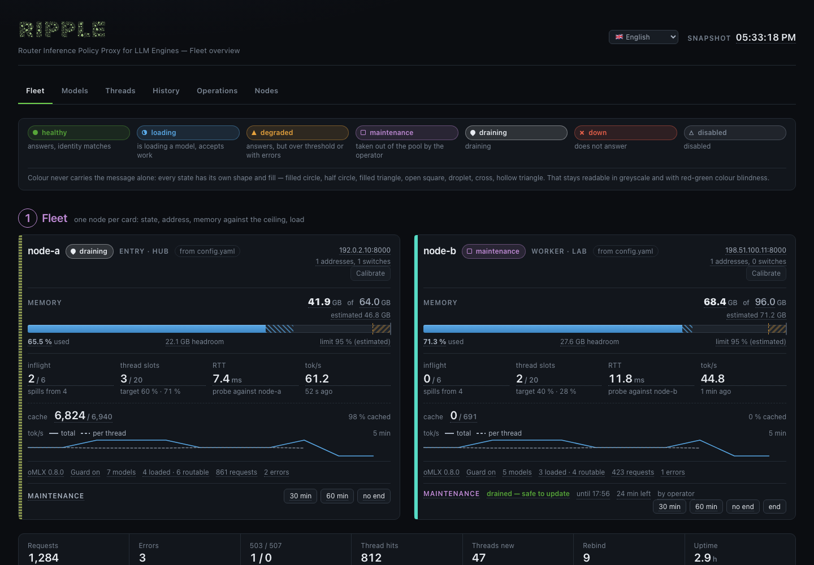
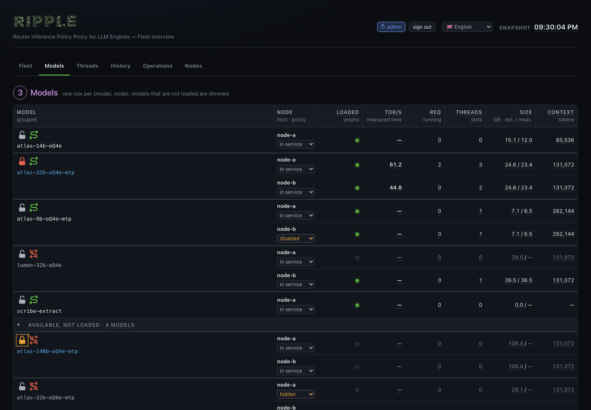

# Installing RIPPLE

English · [Deutsch](install-de.md)

RIPPLE is a placement proxy in front of one or more oMLX nodes. It speaks the OpenAI-compatible API on `/v1` and decides which node answers. The unit of placement is the thread, not the request: a conversation is bound to a node on its first request and stays there for its follow-up turns, new conversations are distributed over the nodes by weight, and a request that would force a node to evict a model another conversation is using is refused with a named reason instead of served.

Three commands do the work:

```
ripple init      # once: port, nodes, location, keys — writes the configuration
ripple doctor    # says what is missing, and sends one real request
ripple           # starts the proxy
```

---

## 1. What RIPPLE is and what you need

RIPPLE does not run models. It needs at least one oMLX instance that already serves them, and it must be able to read that instance's model list — otherwise it has nothing to route.

| | |
|---|---|
| Python | **>= 3.9**. 3.9 and 3.13 are both fine. |
| oMLX | one or more running instances, reachable over HTTP (oMLX listens on `:8000` by default) |
| oMLX API key | only if your node lists models only with a key — see below |
| Network | once, for the install (the build fetches `setuptools`) |

No other tooling is needed: no Homebrew, no `uv`, no `pipx`, no compiler. A `python3 -m venv` and `pip` are enough. `uv` works too, and section 2 shows it.

**The key matters more than it looks.** An oMLX instance answers its model list with `401` when no key is sent:

```bash
$ curl -s -o /dev/null -w '%{http_code}\n' http://127.0.0.1:8000/v1/models
401
$ curl -s http://127.0.0.1:8000/v1/models
{"error":{"message":"API key required","type":"authentication_error","param":null,"code":null}}
```

Without a key a node is unreadable to RIPPLE: it knows no models and can route nothing. The installation still works — the proxy starts, the dashboard shows the node, `ripple doctor` reports the limitation as a warning instead of a failure — but no traffic flows. A node's key usually sits in `~/.omlx/api_key.txt`; `ripple init` looks there and also accepts `$OMLX_API_KEY`.

---

## 2. Install

```bash
git clone <repo-url>
cd ripple

python3 -m venv .venv
./.venv/bin/python -m pip install .

./.venv/bin/ripple --version
# RIPPLE 0.1.0
```

The distribution is named `ripple-proxy` (the PyPI name `ripple` belongs to unrelated projects); the import package and the console script are both `ripple`. The dashboard, its stylesheet and all 16 language catalogs travel inside the wheel.

### `pip install .` works on an old venv, `pip install -e .` does not

A bare `python3 -m venv` on macOS 3.9.6 gives you pip 21.2.4 and setuptools 58.0.4. `pip install .` works there, because the build runs in an isolated environment that fetches a current `setuptools`. `pip install -e .` does not:

```
ERROR: File "setup.py" or "setup.cfg" not found. Directory cannot be installed in editable mode: /Users/you/ripple
(A "pyproject.toml" file was found, but editable mode currently requires a setuptools-based build.)
```

If you want an editable install — you are changing the code — upgrade the build tools first:

```bash
./.venv/bin/python -m pip install -U pip setuptools
./.venv/bin/python -m pip install -e .
```

### With uv

```bash
uv venv .venv
uv pip install --python .venv/bin/python .
```

---

## 3. First run: `ripple init`

```bash
./.venv/bin/ripple init
```

`init` asks five things and writes two files. A run against a single local node looks like this; anything in brackets is the default, and a line without an answer took it. (The configuration check at the end is shortened here to its per-node block.)

```
RIPPLE init — first-run configuration
config:   /Users/you/ripple/config.yaml
key store: /Users/you/.ripple/keys.yaml

Port [8010]:
port: 8010
discovered 1 node(s):
  local  http://127.0.0.1:8000  23 model(s)
Use these nodes? [Y/n]:
node 1/1 (http://127.0.0.1:8000) name [local]: alpha
node 1/1 (http://127.0.0.1:8000) weight [1]:
node 1/1 (http://127.0.0.1:8000) models (comma separated, empty = all offered):
Site name (room, building or city; empty = local) [local]:
Site networks (CIDR, comma separated) [192.0.2.0/24]:
site local: local — 192.0.2.0/24
  loopback: alpha — this machine, no site: written (loopback is in no site's networks; `ripple doctor` reports SKIP)
Use the oMLX key from $OMLX_API_KEY? [Y/n]:
oMLX key: read from $OMLX_API_KEY
node alpha: 23 model(s) offered — allow-list stays empty, which means all of them (restrict with `models:` in the config)
RIPPLE admin key: generated (32 hex) — it is in config.yaml at auth.admin_key and is not shown here

wrote /Users/you/ripple/config.yaml (mode 0600)
wrote /Users/you/.ripple/keys.yaml (mode 0600)

client key "first-client" — shown once, store it now:
  rip-EXAMPLE00000000000000000000000

  use it as:  Authorization: Bearer <the key above>
  later only the masked form is shown; rotate it on the /keys page with the admin key.

— configuration check —
[alpha] role=worker site=- weight=1.0 target=100%
  address:  http://127.0.0.1:8000   status: healthy
  node_id:  4b7d1e0a-9c62-4f38-8a15-2e5c9d7f3b61
  version:  0.8.0rc1   rtt: 0.8 ms
  memory:   219902325555/274877906944 bytes (80.0%), guard=on
  models:   23 offered, 3 loaded

— one real request through the new configuration —
test request: 200 — model qwen3-coder-30b — {"id":"chatcmpl-9f3c1a2b","object":"chat.completion",…}

RIPPLE is configured. Start it with:  ripple --config /Users/you/ripple/config.yaml
```

### What the questions mean

**Port.** Where the proxy listens (`listen_host: 0.0.0.0`, so on every interface). If the port is taken, `init` names the process holding it and offers the next free one:

```
Port [8010]:
port 8010 is already in use by PID 48911 (python3.13)
Use port 8011 instead? [Y/n]:
port: 8011
```

Take the suggestion, or answer `n` and type a port. Either way the rest of this guide assumes `8010` — substitute yours everywhere, including the client base URL and `ripple doctor --url`. Do not stop the process that holds the port just to keep the number.

**Nodes.** Without `--host`, `init` probes exactly one address, `http://127.0.0.1:8000`, and nothing else. A network sweep never happens by itself; that is a separate, explicit command:

```bash
./.venv/bin/ripple discover --scan 192.168.1.0/24
```

`discover` prints one line per node with address, `node_id`, model count, latency and whether admin rights exist; `--json` gives the same as data, `--address` probes a specific node instead of sweeping. Identity comes from `GET /api/cluster/node_id`, never from the address — a node that moved gets found again. An address that answers nothing still becomes a node in the configuration: a node that is down right now is exactly the one you want configured today, so it is picked up when it returns.

**Name, weight, models.** The name is the stable key for thread slots, affinity and every log line; pick something you will recognise in a log. Weight is the target share of new threads — `3` and `2` mean 60 % / 40 %. Leave `models` empty unless you mean to restrict the node: empty means *everything this node offers*, and a written list is an allow-list that freezes today's fleet. A model you add to oMLX next month would stay invisible in RIPPLE, with nothing saying why. That silent failure is the reason the empty answer is the default.

**The location.** After the nodes, `init` asks where this machine stands: a name — the room, the building, the city — and the networks that belong to it, written as CIDR. The order is not cosmetic: those networks are matched against the node addresses, so the nodes have to be known first. The suggestion for the networks is derived from the interface that carries the default route (`ifconfig` on macOS, `ip -o -4 addr` on Linux); loopback (`127.0.0.0/8`) and link-local (`169.254.0.0/16`) are dropped, because an interface that carries only a self-assigned address is not a location. Where nothing can be derived, `init` asks instead of inventing `192.168.0.0/24`.

Pressing Enter takes the default `local` and the derived network. The location is written as one block — the id comes from the name, lower case with hyphens — and `site: <id>` goes **only** on a node whose address really lies inside one of the networks. A node on another network stays without a site instead of inheriting a claim that `doctor` would then have to contradict: a single local node reached over loopback keeps `site=-` while the block exists, and `init` says so in one line instead of leaving you to notice. That is the honest answer, not a gap: `127.0.0.1` means *this machine*, a site names *networks*, and loopback is in none of them — so there is nothing to compare and `ripple doctor` reports `SKIP` with the loopback as the reason (see §4). Once a second machine is configured, its address lies in a network and its `site:` is a claim that is actually checked.

A blank name means **no site**: no `sites:` block, no `site:` on any node, and nothing to warn about or check. The question's default is `local`, so a blank name is a deliberate answer (`--site-name` with a value that strips to nothing) or a hand-written configuration — pressing Enter is not it.

With invented values — documentation networks from RFC 5737 — the two questions look like this:

```
Site name (room, building or city; empty = local) [local]: Werkstatt
Site networks (CIDR, comma separated) [192.0.2.0/24, 198.51.100.0/24]:
site werkstatt: Werkstatt — 192.0.2.0/24, 198.51.100.0/24
  nodes inside it: alpha
```

What that writes — the `sites:` block and the host entry:

```yaml
sites:
- id: werkstatt
  name: Werkstatt
  networks:
  - 192.0.2.0/24
  - 198.51.100.0/24
hosts:
- name: alpha
  addresses:
  - http://192.0.2.10:8000
  weight: 1.0
  site: werkstatt
```

A site written without `networks` is accepted rather than refused: it is a name nobody can check, and `ripple doctor` says exactly that instead of pretending. Two sites whose networks overlap are a warning too — the first site in the file wins.

**The oMLX key.** `init` takes it from `$OMLX_API_KEY`, from `~/.omlx/api_key.txt`, or from your typing (not echoed). An empty answer is valid and means read-only: the configuration is written without a key and the node answers `401` on its model list. The key is never printed and never logged.

**The prefill rate (`pp_tps`).** `init` does not write it, and nothing needs it to start: `hosts[].pp_tps` is a node's measured cold-prefill rate in tokens per second, and it has exactly one job — pricing a move. When RIPPLE moves a bound thread to another node, the thread's whole prompt has to be prefilled there again, which costs `prompt_tokens / pp_tps` seconds; `placement.rebind` weighs that cost against the decode gain before it moves anything, and a node without a rate has no cost model and is never a destination. `placement.rebind.default_pp_tps: 0` means *not measured*, not *infinitely fast*: 0 prices nothing, so every node without its own `pp_tps` is skipped and rebinding is on but cannot fire — `ripple doctor` warns about exactly that (see §4). Take the number from your own measurement (`docs/measurements.md` has the method and the reference values) and write it into the host entry.

### What `init` writes

| File | Content |
|---|---|
| `config.yaml` (current directory, or `--config`) | the configuration, mode `0600`; contains the admin key |
| `~/.ripple/keys.yaml` (or `<home-dir>/.ripple/keys.yaml`) | client keys, mode `0600` |

The admin key is 32 hex characters, generated, written to `auth.admin_key`, and never printed. The client key is printed exactly once — copy it now; afterwards only the masked form is shown. Finally `init` loads the configuration it just wrote, prints the routing table and sends one real completion through the proxy, because a configuration that validates is not the same as one that answers. An existing `config.yaml` or key store is never overwritten: `init` refuses, names the path, and points at `--force`.

Flags (`ripple init --help`):

| Flag | Effect |
|---|---|
| `--yes` | take every default instead of asking — the same code path, so a scripted run produces what an interactive one produces |
| `--force` | overwrite an existing `config.yaml` / key store |
| `--port N` | listen port (default 8010; a busy port moves to the next free one) |
| `--host URL` | oMLX address, repeatable |
| `--name NAME` | node name; only with exactly one node |
| `--config PATH` | where to write `config.yaml` (default `./config.yaml`) |
| `--home-dir PATH` | home directory instead of `$HOME`; the key store goes to `<path>/.ripple/keys.yaml` |
| `--omlx-key KEY` | the oMLX key on the command line instead of the environment |
| `--no-check` | skip the final configuration check and the test request |

Exit codes: `0` configured and checked, `1` refused or cancelled (nothing written), `2` files written but the check did not pass.

---

## 4. Check the installation: `ripple doctor`

```bash
./.venv/bin/ripple doctor --config config.yaml
```

Defaults: `config.yaml` in the current directory, `--url http://127.0.0.1:8010`, `--timeout 10` seconds per network check. Before the proxy runs, `dashboard` and `completion` are skipped — and `site` too, because this install's only node is reached over loopback and there is no network address to hold against the site's networks:

```
RIPPLE 0.1.0 — doctor
config: /Users/you/ripple/config.yaml   proxy: http://127.0.0.1:8010
────────────────────────────────────────────────────────────────────────
OK   python     3.13.9 (requires >= 3.9)
OK   config     /Users/you/ripple/config.yaml — 1 host(s), no warnings
WARN rebind     rebind is on, but no destination has a prefill rate — it cannot fire: 'hosts[].pp_tps' is unset on alpha and 'placement.rebind.default_pp_tps' is 0 — 0 means not measured, not infinitely fast; set 'hosts[].pp_tps' on a node to give a move a price
OK   port       port 8010 on 127.0.0.1 is free — RIPPLE can bind it
OK   node       alpha: http://127.0.0.1:8000 answered in 9.1 ms
OK   identity   alpha: node_id 4b7d1e0a-9c62-4f38-8a15-2e5c9d7f3b61 matches the config
OK   admin      alpha: admin rights (HTTP 200 on /admin/api/activity)
SKIP site       alpha: reached over loopback (http://127.0.0.1:8000) — this machine; a site names networks and loopback is in none, so nothing was compared
OK   keys       /Users/you/.ripple/keys.yaml — 1 key(s), mode 0600, admin key set
SKIP dashboard  no RIPPLE on http://127.0.0.1:8010 — skipped
SKIP completion no RIPPLE on http://127.0.0.1:8010 — skipped
────────────────────────────────────────────────────────────────────────
11 checks: 7 OK, 1 WARN, 0 FAIL, 3 skipped
Result: OK — warnings only, nothing is broken.
```

The one `WARN` is `rebind`, and it is there because `init` cannot know it: no node has a `pp_tps` yet and `placement.rebind.default_pp_tps` is `0`, so nothing in this fleet can price a move and rebinding — on by default — can never fire. It is a warning, not a failure: every request is routed. Write the measured cold prefill of the node into its host entry (`pp_tps: 3680`, see §3) and the line becomes `OK`; leave it out and the balancing between nodes simply does not happen, which is exactly what the line says.

Against a running proxy the last two run instead of being skipped, and the port line says so:

```
OK   port       port 8010 is already serving RIPPLE 0.1.0
OK   dashboard  http://127.0.0.1:8010: /healthz 200, dashboard page 7.3 kB, 1/1 node(s) healthy
OK   completion qwen3-coder-30b answered in 3661 ms via alpha
11 checks: 9 OK, 1 WARN, 0 FAIL, 1 skipped
```

The one skipped check is `site`: the node is reached over loopback, so it *is* this machine and there is no network address to hold against the site's networks. A single-machine install has nothing to verify there, and the line says exactly that instead of leaving you to guess — the same outcome `ripple init` announced when it wrote the block. With a node reached over a network and a `site:` on it, the line is an `OK` or a `WARN` per node — see below.

What is checked, in this order:

| Check | Question |
|---|---|
| `python` | interpreter version against the 3.9 floor |
| `config` | the file loads — through `load_config`, the same call `ripple --check` makes, so doctor cannot bless a file the proxy would refuse |
| `rebind` | whether `placement.rebind` can price a move at all: `WARN` when rebinding is on and no enabled node has a `pp_tps` (with `default_pp_tps: 0`), because then no destination can be chosen and the feature can never fire; `OK` naming the nodes that can be priced; `SKIP` when rebinding is switched off |
| `port` | free, already serving RIPPLE, or held by something else (that one is a `FAIL` and names the process) |
| `node` | per node: which address answered and how fast; `WARN` when it answers but reports itself unhealthy |
| `identity` | per node: the `node_id` it reports against the one in the configuration; `WARN` when the configuration has none or the node cannot be read, `FAIL` on a mismatch |
| `admin` | per node: `GET /admin/api/activity` — `200` is admin rights, `401`/`403` is read-only and a `WARN`, not an error |
| `site` | per node: the declared site against the address that actually answered — `OK` confirmed, `WARN` contradicted (both sites are named) or in none of its networks, `SKIP` when no site is declared, the node is unreachable, or it is reached over loopback (the line says which) |
| `keys` | the key store exists, parses, is mode `0600`, and an admin key is set |
| `dashboard` | `/healthz` returns RIPPLE's payload and `/` returns the dashboard page |
| `completion` | a real completion through the proxy: `/v1/models`, then one chat request |

`node`, `identity`, `admin` and `site` produce one line per node, so the total grows with the fleet — never compare it against a fixed number. Without a `sites:` block and without a `site:` on any host, `site` is a single `SKIP` line for the whole report.

The `site` check is the one that holds a claim against a measurement. The claim is `hosts[].site`; the measurement is the address the node was actually reached through — the one the proxy would use, not necessarily the first entry in `addresses`. If that address lies inside the declared site's networks, the line is `OK`. If it lies inside *another* site's networks, it is a `WARN` naming both sites, and it ends in `the node is not where the configuration says`. If it lies in none of the declared site's networks, it is a `WARN` too: the claim is not contradicted, only unconfirmed, and the usual cause is a forgotten network. A site without `networks` cannot be checked at all — that is deliberate, and `doctor` reports it rather than guessing. A node reached over loopback is the one case with no comparison at all: `127.0.0.1` is this machine, a site that contained it would contain every machine's loopback, so the line is a `SKIP` that names the loopback, and a `site:` written on such a node stays unconfirmed instead of being reported as contradicted.

`OK` means checked and fine. `WARN` means working with a limitation — a node without admin rights is the normal case for anyone who does not hold oMLX's own key, and it must not read as a broken installation; **a `WARN` does not change the exit code**. `FAIL` is exit code 1. `SKIP` means the check could not run, usually because no proxy was listening yet.

The last check decides whether the installation is usable: it sends a completion through the proxy, so a green report with a red `completion` still means nothing works.

`--json` prints the same report as data — `version`, `config`, `url`, `checks`, a `summary` with `checks`/`ok`/`warn`/`fail`/`skipped`, and `exit_code`.

---

## 5. Start it

```bash
./.venv/bin/ripple --config config.yaml
```

It logs to stderr and to the rotating file named by `log_file` (`~/Library/Logs/ripple.log` in `config.example.yaml`, 10 MB × 5 files). Other flags: `--host` and `--port` override `listen_host`/`listen_port`, `--log-level` overrides `log_level`, `--reinit` re-resolves every node address before starting.

To check the configuration and the nodes without accepting a single request:

```bash
./.venv/bin/ripple --config config.yaml --check
```

`--check` builds the fleet, binds no port, prints the per-node block and the routing table, and exits `0` if at least one node is healthy, `2` if none is.

### As a service (launchd, macOS)

```bash
deploy/install-launchd.command
```

The script frees port 8010, renders `deploy/ai.ripple.plist` (a template with `__REPO__` and `__HOME__` placeholders) into `~/Library/LaunchAgents/`, writes the oMLX key from `~/.omlx/api_key.txt` into it, sets the file to `0600`, loads the agent and checks `/healthz`. `--dry-run` prints what it would do and changes nothing; it fails loudly if the key file is not readable, because the agent cannot start without it.

```bash
launchctl print gui/$(id -u)/ai.ripple | head -20
```

The agent starts at login and restarts after a crash, but not after a clean exit. Details, the manual sequence and how to unload it: [`deploy/README.md`](../deploy/README.md).

---

## 6. Point a client at it

The client now talks to `http://<host>:8010/v1` instead of `:8000/v1`, with a **client key** from `ripple init` (not the admin key):

```bash
curl -s http://127.0.0.1:8010/v1/chat/completions \
  -H "Content-Type: application/json" \
  -H "Authorization: Bearer $RIPPLE_CLIENT_KEY" \
  -H "X-Session-Id: my-session" \
  -d '{"model":"qwen3-coder-30b","messages":[{"role":"user","content":"Hello"}],"max_tokens":128}'
```

Anything that speaks the OpenAI API works: set its base URL to `http://<host>:8010/v1` and its key to a client key. Clients that read `OPENAI_BASE_URL` need nothing else.

Every answer carries `x-ripple-host` and `x-ripple-reason`:

```
x-ripple-host: alpha
x-ripple-reason: resident
```

The host is the node that answered. The reason is a short token from a fixed vocabulary — `resident` (the model was already loaded there), `cold_load` (it has to be loaded), `new_thread`, `thread` (a known conversation staying where it is), `fallback` (its node was gone, the thread moved), `model_pinned` (only one node offers this model), `degraded_host` (served from a node that missed a probe rather than failing). When a thread holds a slot, `x-ripple-thread` names it.

**`X-Session-Id` is optional and worth sending.** The placement unit is the thread, not the request: an id per conversation means RIPPLE never has to guess, and an agent that sets its own id is never moved to the wrong node. Without the header RIPPLE recognises the thread by a fingerprint of model plus first user message — the system prompt is excluded because it carries timestamps — and then by prefix similarity, which survives a compressed conversation.

**Emergency path.** If the proxy itself is down, the node still serves on `:8000`. Point the client at `http://<host>:8000/v1` — one line — and RIPPLE holds no state that would have to be recovered before you go back.

---

## 7. The dashboard

`http://<host>:8010/` — one page, no CDN, no build step, refreshed every 2 seconds.



At the top, a legend and then one card per node: state, role, addresses, memory against the ceiling with the 95 % admission line and the remaining headroom, `inflight` against the spill threshold, thread slots against the target share, RTT, tok/s, model counts, requests and errors. Status is colour **and** shape — circle, half circle, filled triangle, open square, droplet, cross, hollow triangle, one per state — so it stays readable in greyscale and with red-green colour blindness. Below the cards, counters for the whole fleet: requests, errors, 503/507, thread hits, new threads, rebinds, uptime.



Further down: **Models** (one row per model and node, models that are not loaded are dimmed), **Distribution** (target share against the actual share of thread slots), **Threads** (who holds a slot, idle time, remaining time), **Load per host** (idle, loading, prefill and decode as exclusive seconds), **Last interaction round**, and the **Operations** block: maintenance, model policy, calibration, replication, parameters, restart.

- The language is chosen in the header. The choice is stored in `localStorage['ripple_lang']`; 16 catalogs ship with the package.
- The operator panels need the admin key. Enter it on the key page, `http://<host>:8010/keys`; it stays in that tab (`sessionStorage`), is sent as a bearer token on each call, never appears in the URL and is never rendered into the page. Without it the panels say so instead of failing.
- **Maintenance** takes a node out of the pool for 30 minutes, 60 minutes or without an end. Running requests finish, new work goes to the other nodes. This is the gentle way to swap a model: drain first, then update. The same control ends the window.

---

## 8. Keys

| Key | Where | What it opens |
|---|---|---|
| Admin key | `config.yaml` → `auth.admin_key` (generated by `init`, 32 hex) | `/admin/*` and `/keys`: maintenance, model policy, calibration, replication, key management |
| Client keys | `~/.ripple/keys.yaml`, mode `0600` | `Authorization: Bearer …` on `/v1/*` |
| oMLX key | `defaults.api_key`, or `hosts[].api_key` per node; `${VAR}` is expanded | RIPPLE → oMLX |

Client keys are shown in full exactly once, at creation. On `/keys` you can create one (name, kind — `interactive`, `batch`, `one-shot` — and an optional model list), rotate it, disable it and revoke it; every one of those calls requires the admin key. Rotating prints the new value once, like creation does.

**One trap worth naming:** do not set `auth.admin_key` to the same value as the oMLX key. A hand-made configuration invites it, and then one leaked admin key opens both the proxy's admin routes and every oMLX node behind it. `ripple init` generates a separate key for exactly this reason.

---

## 9. Troubleshooting

**Everything answers 401.** The oMLX key is missing or wrong. This includes `GET /v1/models`, which is what makes the failure look like a proxy problem:

```bash
curl -s -o /dev/null -w '%{http_code}\n' \
  -H "Authorization: Bearer $OMLX_API_KEY" http://127.0.0.1:8000/v1/models
```

`200` means the node is fine and RIPPLE's key is not. Put the key in `defaults.api_key` (or in `hosts[].api_key` for one node) and restart.

**The proxy does not start on Python 3.9.** FastAPI evaluates the annotations of a route handler when it builds the app, and `minutes: float | None` raises `TypeError: unsupported operand type(s) for |` there. Every module imported cleanly, so neither an import check nor `--check` could see it; the traceback appears only at startup, inside FastAPI's route setup. Fixed in 0.1.0 — the annotation is `Optional[float]` now, with a static test that runs on every interpreter. On an older build, run on 3.10+ or upgrade.

**A response with empty `content` and only `reasoning_content`.** The token budget was too small and a thinking model spent all of it on reasoning:

```json
{"choices":[{"message":{"role":"assistant","content":"",
  "reasoning_content":"The user asks to reply with the single word: ok. So I should"},
  "finish_reason":"length"}],
 "usage":{"completion_tokens":16,"completion_tokens_details":{"reasoning_tokens":16}}}
```

`finish_reason: length` with `completion_tokens` equal to `reasoning_tokens` is the signature. Use at least `max_tokens: 128` for a thinking model. A model that answers with reasoning only is not broken — it answered, the budget ran out before the visible part.

**A healthy node but no models in the proxy.** Two causes: the key is missing (see the 401 above), or `models:` in the configuration is too narrow. A written list is an allow-list; empty means everything the node offers. `ripple doctor` shows per node what is offered and what is loaded, and `--check` prints the routing table.

**HTTP 503 naming a model.** The eviction guard refused. `model_locked` means the model's memory is held by a model the operator locked, and the message names it plus the endpoint that unlocks it (`DELETE /admin/models/<model>/lock`). `conflict` means no node could take the request without evicting a model a running thread holds; the message lists each node with its reason. Both are deliberate: an honest 503 beats silently evicting a session someone is using. Options: take the node into maintenance, wait for the running threads to finish, or send the request to a node that offers the model.

**The dashboard has no translations or no styles.** The wheel was built without the static data. Check the catalogs:

```bash
ls .venv/lib/python*/site-packages/ripple/static/i18n/*.json | wc -l   # 16
```

Fewer than 16 means a broken wheel — reinstall from a clean checkout.

**`doctor` warns on `admin`.** The node answered, but `GET /admin/api/activity` returned `401` or `403`: the configured key is not oMLX's own key. That is normal for a node you do not administer, and not an error. What you lose is maintenance control, model policy and the resident model sizes — and with them the eviction forecast, which switches itself off visibly rather than silently: `eviction_guard: false` in `/healthz` and a banner on the dashboard.

**Port already in use.** `init` names the process (PID and name, from `lsof`) and offers the next free port. `doctor` reports a held port as `FAIL` and names the holder too. Do not kill a running proxy to get the port back — pick another one.

---

## 10. Where things live

| Path | Content |
|---|---|
| `config.yaml` | the configuration, mode `0600`, contains the admin key |
| `~/.ripple/keys.yaml` | client keys, mode `0600` |
| `~/.ripple/maintenance.yaml` | maintenance windows (which node is out, until when) |
| `~/.ripple/models.yaml` | model policy: `(node, model)` switched off or hidden |
| `~/.ripple/calibration.yaml` | calibration samples for cold-load estimates |
| `~/.ripple/host_stats.json` | per-node counters (idle, loading, prefill, decode) |
| `~/.ripple/runtime.yaml` | the runtime overlay: nodes added or disabled at the page, and the routing policy set there |
| `~/Library/Logs/ripple.log` | the log, rotating 10 MB × 5 |

Every operator store can be moved in the configuration: `placement.maintenance_file`, `placement.model_policy_file`, `placement.loading.calibration_file`, `auth.keys_file`, `stats.file`, `fleet.file` (the runtime overlay) and `log_file` for the log. Nothing is written next to the code.

`~/.ripple/runtime.yaml` is an **overlay**, never a replacement: `config.yaml` stays the baseline and RIPPLE never writes into it. The file carries three blocks —

```yaml
hosts:
  overrides:            # a host from config.yaml, changed at the page
    alpha: {weight: 2.0}
  nodes:                # a machine added at the page (deletable again)
    M5-beta: {addresses: ["http://192.0.2.40:8000"]}
policy:                 # routing policy set at the page (issue #78)
  affinity: {ttl_seconds: 900}
  placement: {rebind: {max_per_hour: 6}}
```

— and is written atomically (`.tmp`, fsync, rename) with mode `0600`, because an overlay node may carry an oMLX key. An override may change only the operator's decisions for a host — `enabled`, `weight`, `site`, `spill_threshold`, `prefer_resident` — never its identity (address, `node_id`, key, backend, limits): a machine the page can redefine is a machine that can silently become another one.

Since issue #78 the routing policy can be set without editing the file at all: `PATCH /admin/config/{dotted.path}` sets one value (for example `affinity.ttl_seconds` or `hosts.alpha.weight`) and `DELETE` on the same path drops the override so the value from `config.yaml` applies again. Both are behind `auth.admin_key` and both go through the loader's own parser, so a value that would be refused at start-up is refused here with the same message. A weight change applies to new threads only — the running ones keep their host until they end — so a change that would place them differently asks for confirmation and names how many threads would move.

A `fleet.yaml` from before the rename is still read, once, with a warning; the first write creates `runtime.yaml`. Nothing else is migrated.

To uninstall:

```bash
launchctl bootout gui/$(id -u)/ai.ripple      # if it runs as a service
rm ~/Library/LaunchAgents/ai.ripple.plist
rm -rf ~/.ripple
rm -rf /path/to/ripple                        # the checkout and its .venv
```

Nothing else is left behind — no system-wide files, no daemon, no state outside those paths.

---

## 11. Where to read more

- [`README.md`](../README.md) — what RIPPLE does, the routing rules in detail, the configuration shape.
- [`docs/manual-en.md`](manual-en.md) — the operator's manual: every panel and every control, what it costs and what can go wrong (§4 is the optimizer, §6.6 covers the key page).
- [`docs/requirements.md`](requirements.md) — the specification: every rule with its number, and why it is a rule.
- [`docs/commissioning.md`](commissioning.md) — putting it into operation, including how to switch a client over and roll back.
- [`docs/dashboard-design.md`](dashboard-design.md) — what the page shows and why, down to the individual panel.
- [`docs/olla-evaluation.md`](olla-evaluation.md) — the measured evaluation of an off-the-shelf proxy, and why this one exists instead.
- [`SECURITY.md`](../SECURITY.md) — how to report a vulnerability, and the weaknesses that are stated on purpose (no TLS, LAN only).
- [`config.example.yaml`](../config.example.yaml) — every knob with a comment; the reference when you want more than `init` writes.
- [`CONTRIBUTING.md`](../CONTRIBUTING.md) and [`CHANGELOG.md`](../CHANGELOG.md) — how to work on it, and what changed between versions.
