# RIPPLE — Operator's Manual

*Router Inference Policy Proxy for LLM Engines · for the person who runs it, not the person who wrote it*

---

**About the screenshots and the examples.** Every picture was taken from a running
RIPPLE dashboard with two nodes, six conversations and one machine that is only
ever previewed on the Nodes tab. The fleet is a test fleet: the addresses are
documentation addresses (`192.0.2.0/24`, `198.51.100.0/24`), the node names are
`node-a`, `node-b` and `node-c`, the node ids are invented, and the model names
in the pictures are invented as well. Nothing in the pictures is taken from a
production installation. The model names, sizes and rates in the running text are
examples too, but not all of them are invented: the ones from a real installation
— `DeepSeek-V4.1-Flash-1017-oQ4e-mtp` in §3.2, §5.6.3 and §7.1 is one — are
printed as they were, and the names in the two scenarios of §9 are made up. None
of them says anything about what your fleet runs or what RIPPLE supports. Your
own page will show your own numbers in the same places.

---

## 1. What RIPPLE is — and what it is not

RIPPLE is a window in front of your oMLX nodes, not a part of them. It accepts
OpenAI-compatible requests, decides which machine should answer each one, forwards
it there, and shows you what happened; it never patches or configures a model, and
it changes nothing in the oMLX installation. Most loads it only *causes*: a request
placed on a node that does not hold the model makes oMLX load it, and RIPPLE
supervises that load without starting it. Two loads it does start itself, both of
them because you asked for something and both of them named on the page: a
**calibration** (§6.3) loads the models it measures and unloads what it had to move
out of the way, and a **locked or pinned** model is preloaded as soon as its node
is healthy (§5.2.2) — the lock is a promise of residency, so RIPPLE pays it
without waiting for a request, displacing an idle unlocked model if that is what
it takes, but never a model that is serving. Nothing else asks oMLX to load or
unload anything. What it does own is *routing state* — which
conversation lives where, which (node, model) pair is switched off, which machine
is in maintenance — and it keeps that state in its own files under `~/.ripple/`,
never in oMLX's settings. If RIPPLE is stopped, the nodes keep serving on their own
ports and a client can be pointed straight at one of them; that is the emergency
path, and it is one line of configuration. The reason the distinction matters is
that everything you can do from the dashboard is reversible by definition: no click
on this page can leave a model missing, a setting changed, or a machine in a state
you cannot undo.

## 2. Installing in five lines

```bash
git clone <repository> ripple && cd ripple
python3 -m venv .venv && ./.venv/bin/pip install .
./.venv/bin/ripple init                     # writes config.yaml and the key store
./.venv/bin/ripple doctor --config config.yaml
./.venv/bin/ripple --config config.yaml     # the dashboard: http://127.0.0.1:8010/
```

That is the whole path for a single node on the same machine. The details —
Python floor, `uv`, the launchd agent, the key store, what lives where — are in
[`install.md`](install.md); this manual does not repeat them. Read that once
during installation and come back here to run the thing.

## 3. First start

### 3.1 `ripple init` — what the six questions mean

`init` asks, writes two files, and finishes by sending one real request through
the configuration it just wrote. Every question has a default in brackets;
pressing Enter takes it.

| Question | What it decides | Default |
|---|---|---|
| **Port** | Where the proxy listens. If the port is taken, `init` names the process holding it and offers the next free one. A port outside 8010–8099 is accepted but named with its consequence (the dashboard, `ripple doctor` and `ripple start` follow it) and confirmed once, default no — the range is documented, not enforced, and a typo like `8199` for `8099` should not pass as a decision. | `8010` |
| **Use these nodes?** | Whether the discovered addresses become the fleet. Without `--host`, `init` probes exactly one address, `http://127.0.0.1:8000`; a network sweep is a separate command (`ripple discover --scan …`). | yes |
| **Name, weight, models** (per node) | The name is the stable key for thread slots, affinity and every log line — pick something you will recognise. A node typed at the address question gets a suggestion (`local` for loopback, otherwise `node-…` from its `node_id`), and an empty answer keeps it. The weight is the target share of new threads: `3` and `2` mean 60 % / 40 %. The question takes whole numbers 1–20 and asks again on anything else — `abc`, `1.5`, `0` and `21` each get their own sentence instead of being silently replaced by the default; the configuration file itself accepts any positive float, so a hand-edited `1.5` stays valid. An empty answer takes the chat-capable models (`model_type` `llm`, `vlm`, …) and `init` names the utility engines it left out (`markitdown`, `embedding`); answer `all` to keep the list empty — *everything this node offers*, utility engines included — and a written list is an allow-list, written exactly as typed, that freezes today's fleet. The type is the node's own declaration and not always what an operator would call a chat model — a speculative-decoding draft model (`…-drafter`) is declared `llm`; name it out or hide it with the policy (§6.2). | `local`, `1`, empty |
| **Site name and networks** | Where the machine stands — a room, a building, a city — and the networks (CIDR) that belong to it. The site is checked against the address a node is actually reached through, by `doctor` and on the fleet card. A blank name means *no site*, and nothing is checked. | `local`, derived from the default route |
| **Scan the networks?** | Offered right after the networks, default **no** (a sweep is traffic on someone else's network). `y` sweeps every CIDR for oMLX on port 8000 and asks each node it finds name, weight and models; a node already in the fleet is skipped by `node_id`. |
| **The oMLX key** (per node) | Asked **before** the node list (issue #180), so the discovery line can carry the model count it actually read; taken from `$OMLX_API_KEY`, from `~/.omlx/api_key.txt` if it is there, or typed (not echoed). The first answer is the fleet default: every further node is asked `same oMLX key as node 1?`, because a fleet of clones is the normal case. A node that answers `401` with the key it was given is asked once more for its own — machines each with their own `~/.omlx/api_key.txt` are just as normal — and a key that differs is written as `hosts.<name>.api_key_file` — the value itself goes to `~/.ripple/secrets.yaml` (mode 0600), so the configuration can be shared without the keys in it (`ripple doctor` says `OK secrets` when that holds). An empty answer is valid and means read-only: the node then answers `401` on its model list, and RIPPLE can route but not see what the node carries. | the key if found |
| **The RIPPLE admin key** | Empty generates a 32-hex key, which `init` prints once (the dashboard's operator panels ask for exactly that key, so it has to be in your hand at the end of the install). A key you type is used exactly as given and never echoed — only its length is reported, and a short one is a legitimate choice, not an error. | generated |

What it writes: `config.yaml` (mode `0600`, containing the admin key) and
`~/.ripple/keys.yaml` (the client keys, mode `0600`). Two keys come out of it and
they are not interchangeable:

- the **client key** — printed exactly once, at the end. It is what Hermes,
  opencode or `curl` send as `Authorization: Bearer …`. Copy it now; afterwards
  only its masked form is ever shown.
- the **admin key** — asked for, or generated when you press Enter, and printed
  exactly once when it is generated (a key you typed is never echoed back). It
  unlocks the write controls on the dashboard and the `/keys` page, and it is
  also in `auth.admin_key`.

An existing `config.yaml` or key store is never overwritten: `init` refuses, names
the path, and points at `--force`.

### 3.2 `ripple doctor` — what green means

`doctor` runs a fixed list of checks against the configuration *and* the machines,
and prints one line per check with `OK`, `WARN`, `FAIL` or `SKIP`.

| Verdict | Meaning | Exit code |
|---|---|---|
| `OK` | checked, and fine | 0 |
| `WARN` | working, with a limitation you should know about — a node without admin rights, a site that does not match the address, a node that answers but reports itself unhealthy | 0 |
| `FAIL` | something is wrong and must be fixed — a port held by another process, a `node_id` that contradicts the configuration | 1 |
| `SKIP` | the check could not run, usually because no proxy was listening yet | 0 |

**Green means checked, not guessed.** The line that decides whether the
installation is usable is the last one: `completion` sends a real chat request
through the proxy. A report that is green everywhere except `completion` still
means nothing works.

Before the proxy runs, `dashboard` and `completion` are skipped, and so is `site`
while no node declares a location. Against a running proxy they run, and the
`port` line says so:

```
OK   python     3.13.9 (requires >= 3.9)
OK   config     /Users/you/ripple/config.yaml — 1 host(s), no warnings
OK   port       port 8010 is already serving RIPPLE 0.1.0
OK   node       node-a: http://192.0.2.10:8000 answered in 2.4 ms
OK   identity   node-a: node_id matches the config
OK   admin      node-a: admin rights (HTTP 200 on /admin/api/activity)
OK   site       node-a: 192.0.2.10 is inside hub (192.0.2.0/24)
OK   keys       /Users/you/.ripple/keys.yaml — 1 key(s), mode 0600, admin key set
OK   dashboard  http://127.0.0.1:8010: /healthz 200, dashboard page 7.3 kB, 1/1 node(s) healthy
OK   completion DeepSeek-V4.1-Flash-1017-oQ4e-mtp answered in 3661 ms via node-a
```

`--json` prints the same report as data. The full check list, and what each one
asks, is in [`install.md`](install.md) §4.

## 4. The optimizer — moving one conversation, and what a move costs

**The idea.** Every thread — every conversation — holds its prefix cache on exactly
one node. That is what the cache is: the prompt the node has already read, kept warm
on that machine and nowhere else. Two things follow, and they pull in opposite
directions. **Move the thread** and the destination has to read the whole prompt
again before the next token appears — one full re-prefill, `prompt_tokens / pp_tps`
seconds, paid by the next turn. **Leave it** and the node carries one more long
stream on top of the ones already running there, and every stream on that node
decodes slower than it would alone. The optimizer's whole job is to decide which of
the two is cheaper — and it decides with measurements: the per-stream decode rate at
each concurrency level, per node and per model, as the fleet actually ran them. No
rule of thumb, no "spread it evenly".

### 4.1 The criterion: relative load picks the source, Δtotal picks the destination

Two questions, two different numbers.

**Where does a thread come from?** From the node with the highest **relative load** —
`1 − rate_now / rate_alone`, the fraction of its single-stream speed that is being
lost to sharing right now. `0 %` means the node still answers one stream as fast as
it would alone; `—` means nothing has been measured yet. A tie goes to fleet order,
so two scans of the same fleet decide the same way. A node with no measured curve for
the model in question cannot be scored at all and is not a source.

**Where does it go?** Not "the other one" — the node with the highest **Δtotal**:

```
[(m+1)·rate_dst(m+1) + (n−1)·rate_src(n−1)] − [m·rate_dst(m) + n·rate_src(n)]
```

with `n` the source's streams including the one that would leave, and `m` the
destination's before it arrives. Both sides are the fleet's **aggregate** decode
rate, before and after one thread moves, so batching is inside the number. The
destination is wherever that difference is largest, which is not the same as the
least loaded node. `Δtotal ≤ 0` is a decision too: the move does not happen, and the
reason names the number (`delta_non_positive`).

**Why an uneven distribution can be the optimum.** Every reader's first instinct is
"spread the threads evenly". The measurement says otherwise, because the aggregate is
not the per-stream rate. On the reference fleet (`docs/concurrency.md`, 400-token
prompt, 500 completion tokens, measured directly against each oMLX):

| concurrent | M5 per stream | M5 aggregate | M3 per stream | M3 aggregate |
|---|---|---|---|---|
| 1 | 62.5 tok/s | 62.5 | 27.8 | 27.8 |
| 3 | 20.6 | 61 | 21.7 | 64 |
| 6 | 16.9 | 99 | 11.9 | 70 |

Per-stream decode collapses with every extra stream, while the aggregate **rises** —
62.5 to 99 tok/s on the M5 at six streams. A node whose streams have slowed down
badly is therefore not automatically overloaded: it is producing more tokens per
second than it would with one stream. That is exactly why the criterion is the
difference of two aggregates and not the difference of two loads, and why the optimum
can be lopsided: the fleet is faster when one machine batches several streams and the
other carries one. Only when the marginal stream costs more in total than it adds —
where the aggregate stops growing — does moving it pay.

**And then the guards.** Δtotal is necessary, not sufficient. The move must also pay
off for the thread that moves: `gain = assumed_completion_tokens ×
(1/rate_src(n) − 1/rate_dst(m+1))` — the seconds its *next* answer wins — has to be at
least `placement.rebind.min_gain_seconds`, and at least `cost ×
placement.rebind.safety_factor`. The gain is measured over `assumed_completion_tokens`
and not over the whole conversation: it is what the next 400 tokens buy (the default).
A conversation that runs much longer than that is a different number, and the one knob
to look at when the optimizer seems too quiet.

### 4.2 What it has to know: `rate_h(n)`, per node and per model

The decision rests on one function: `rate_h(n)`, the per-stream decode rate at `n`
concurrent streams, for **one node and one model**. It is not a constant and not a
config value; it is measured from the traffic that actually ran.

- **Where it comes from.** The tachograph (`#83`): every probe tick takes a 5-second
  bucket of `(n, rate)` per node and model into a ring of 720 buckets — one hour.
  `/healthz` serves the last 900 s as `hosts[].series`.
- **What counts as a point.** Only *clean* buckets: `n ≥ 1` (a bucket in which nothing
  ran has no per-stream rate) and an integer `n` (a 5-second window that held one idle
  and one busy tick averages 1.5 — an artefact of the bucket width, not a concurrency
  level the node ever ran at). A level exists once **at least 3 clean buckets** agree
  on it: one bucket is an anecdote, and the optimizer must not divide by an anecdote.
- **How long that takes.** Three 5-second buckets at the same concurrency — about 15
  seconds of decode per node and model **per level**. A level the fleet never ran is
  simply absent, and one move needs up to four of them: `n` and `n−1` on the source,
  `m` and `m+1` on the destination.
- **No calibration produces it.** `Calibrate` (§6.3) times how long a node takes to
  *load* a model — the ETA on the card. It says nothing about decode rate, and no
  sweep is run for the optimizer's sake. A fresh installation therefore moves nothing
  until its nodes have decoded under real traffic; that is the contract, not a defect.
- **Nothing is interpolated or extrapolated.** A missing level makes the move
  unevaluable rather than approximate: the reason is `no_curve` and the fleet stays as
  it is. The optimizer never guesses a rate between two measured points or beyond the
  last one.
- **A price is needed as well.** `hosts[].pp_tps` — the node's measured cold-prefill
  rate — prices the move. A node without one is never a destination (§4.4).
- **And the thread's size.** A thread whose prompt size was never recorded is not moved
  (`price_unknown`): a price of 0 would look free.

### 4.3 What you see

**Two lines in block 1.** On each node card in the Fleet tab (§5.1) the `thread slots`
cell has two lines:

```
3 / 8
target 60 % · 16 %
```

The first line is the slots in use against `max_threads` — how many conversations hold
a slot on this node right now. The second is the comparison the optimizer works from:
the **target share** from the node's weight (`3` and `2` mean 60 % / 40 %) on the left,
the **relative load** on the right, as a bare number. Read them together: the target is
the intention, the load is the reality. A node well below its target with a low load is
doing its share comfortably; a node at its target with a load near 100 % has nothing
left for the streams it carries. A `—` instead of a number means *not measured yet*,
not zero load: without a measurement nothing is being said about the machine. The word
"load" is not on the card — it is in the tooltip of the cell, with the definition and
the field it comes from (`/healthz → hosts[].relative_load`). Two percentage figures
and no room for two words in sixteen languages is the trade the design made; the
reasoning is in `docs/dashboard-design.md`.

**One log line per move.** A move is an event, not noise, so it is logged at `warning`:

```
rebind thread=<key> src=<node> dst=<node> delta_total=<+tok/s> gain_seconds=<s> cost_seconds=<s> model=<model>
```

Read it left to right: which thread moved, from which node to which, what the fleet's
aggregate decode rate gained (`delta_total`, tok/s), what the thread's next answer gains
(`gain_seconds`), what the re-prefill costs (`cost_seconds`), and for which model.
`delta_total` and the two seconds are the numbers the decision was made on — if a move
looks wrong, this line is the whole argument for it.

**Skips are quieter.** A scan that decides *not* to move logs at `debug`, one line per
scan: `optimizer_skip reason=… delta_total=… detail=…`. At the default log level you
will not see it; raise the level when you want to know why nothing happens.

| reason | what it means |
|---|---|
| `ok` | a move was made — the `rebind` line above |
| `delta_non_positive` | the move was evaluated and the fleet total would not rise; `delta_total` carries the number |
| `no_curve` | a level the decision needs has not been measured; nothing is guessed |
| `price_unknown` | the thread's prompt size was never recorded, so the move cannot be priced |
| `cost_exceeds_ttl` | the re-prefill would outlast the slot's remaining TTL |
| `min_gain` | the thread's next answer would gain less than `min_gain_seconds` |
| `cost_not_repaid` | the gain does not beat the cost by `safety_factor` |
| `cooldown` | this thread moved inside `per_thread_cooldown_seconds` |
| `budget` | the hourly move budget is used up — the optimizer's or rebind's |
| `batch_no_rebind` | the only idle threads are batch threads; their TTL is too short to amortise a prefill |
| `no_target` | nothing is idle anywhere |
| `disabled` | `placement.optimizer.enabled` or `placement.rebind.enabled` is false |

**In the thread list.** The moved thread keeps its key, its model and its turn count;
what changes is the **host** column (§5.3). It also shows up freshly idle — `0 s idle`
— and its remaining-slot countdown starts again at the full TTL, because the move
stamps the thread as seen now. In the fleet counters, `rebinds` in the KPI strip goes
up by one.

### 4.4 The knobs

All under `placement` in `config.yaml`; a change needs a restart.

| key | default | what the value does |
|---|---|---|
| `optimizer.enabled` | `true` | `false` starts no scan task at all — one `info` line at start-up, and the fleet never moves a thread on its own. The per-request guards have their own switch (`rebind.enabled`); both must be on for a move. |
| `optimizer.interval_seconds` | `30` | The scan period. One scan moves at most **one** thread, so this is also the fastest possible pace of moves. It must be greater than 0 — the configuration is refused otherwise, because a zero interval is a busy loop, not a schedule; the loop floors it at 1 s. |
| `optimizer.max_moves_per_hour` | `4` | The optimizer's own budget; `0` means no limit. It sits **on top of** `rebind.max_per_hour` (also `4`), which counts every deliberate move including the optimizer's — so the effective ceiling is whichever runs out first. |
| `rebind.min_gain_seconds` | `2.0` | The floor for `gain_seconds`: a move must buy at least this much for the thread's next answer or it is churn. Raising it makes the optimizer quieter, not smarter. |
| `rebind.safety_factor` | `1.5` | The gain must exceed the prefill cost by this factor. `1.0` would accept a move that only breaks even; the margin is the point, because the cost is paid in full and the gain is an estimate. |
| `rebind.per_thread_cooldown_seconds` | `600` | After a move the thread is out of the candidate list for this long — a flap guard: a thread that just paid its prefill must not pay it again ten seconds later. |
| `rebind.default_pp_tps` | `0.0` | A fallback price for nodes without their own `pp_tps`. `0` means **not measured**, not infinitely fast: it prices nothing, so those nodes are never destinations. With `0` and no node carrying its own rate, the optimizer is on and has no destination at all — `ripple doctor` warns about exactly that and the start-up log repeats the sentence (`#81`). |

Two more conditions are not knobs but explain most skips: the destination must already
have the model **loaded** (a cold load on top of a prefill never pays), and the cost
must fit in the slot's remaining TTL. Both follow the same rule — the move has to be
repaid by the conversation that is still there.

### 4.5 Where it does not help

- **One client, one thread.** A thread is the unit: all of its streams move together.
  A single agent with one conversation cannot be spread over the fleet, and with two
  threads in the whole fleet any 3 : 2 weighting is arithmetically meaningless. The
  optimizer will correctly decide to move nothing.
- **A very long context.** The price of a move is the *whole* prompt, and a thread with
  hundreds of turns of history is a prefill the next answer rarely repays — the cache
  is worth more where it is. The candidate list is ordered cheapest-first for this
  reason: the small conversations move, the big ones stay.
- **A node without a measured curve** is invisible — not a source, not a destination.
  The same holds for a node without `pp_tps`, which cannot be priced at all.
- **A fleet with no idle thread** has nothing to move (`no_target`). The optimizer only
  ever moves threads that are not working: it never interrupts a request to rebalance,
  and it never runs in the request path.
- **It does not make a single request faster.** It changes who shares a machine. If one
  node is slow for a reason that is not concurrency — a cold model, a busy disk, a WAN
  link — no placement decision fixes it.

## 5. The dashboard

Open `http://<host>:8010/`. One page, no CDN, no build step, refreshed every two
seconds; the time in the masthead is the moment of the last pull, not a clock
that keeps running. The open tab is the URL hash (`#fleet`, `#models`,
`#threads`, `#history`, `#ops`, `#nodes`), so a reload and a language switch both
land where you were. The language selector in the masthead carries sixteen
catalogs; the choice is stored in the browser (`localStorage['ripple_lang']`).

**A fix reaches the page on a plain reload.** The stylesheet and the script are
linked as `/static/dashboard.css?v=<mtime>` and `/static/dashboard.js?v=<mtime>`
— the mtime of each file, not a release number. Without it the browser's
heuristic cache decides whether to ask at all: `StaticFiles` sends `ETag` and
`Last-Modified` but no `Cache-Control`, so a normal reload can show yesterday's
CSS while the server already serves today's. With the mtime in the URL every
edit is a new URL, and a reload is enough.

Six tabs, in the order the page numbers them:


| Tab | Answers |
|---|---|
| **1 Fleet** | What are the machines doing right now, and how is the work split? |
| **3 Models** | Which model is loaded where, how big is it, and what is switched off? |
| **4 Threads** | Who holds a slot, on which node, and for how much longer? |
| **5 History** | Why did the last requests land where they landed? |
| **6 Operations** | The six operator actions, and the parameters in force. |
| **7 Nodes** | Which machines serve the fleet — add one by address, take one out with a drain. |

**The update hint (issue #123).** Once per start — in the background, after the
page is already answering — RIPPLE asks the public GitHub releases API whether a
newer release exists. If one does, the line under the masthead's tagline says so
in the page's language and names the command: `ripple update`. It is a link to
the release page and nothing more: RIPPLE downloads and installs nothing, and
the command it names runs the test suite before it restarts anything.

The hint only ever points forward. A checkout that is *newer* than the last
public release — the normal state of the internal forge branch — reads `current`
and shows nothing, and a check that cannot answer (no internet, a timeout, no
release published yet) is a silent `unknown`: no warning in the log, no line in
the header. `update.check: false` in `config.yaml` turns the request off
entirely, for a machine that has no internet and should not spend a timeout on
it every start. The result is in `GET /healthz` → `update`
(`state`, `latest`, `url`, `checked_at`), next to `version`.

The last tab is the only one that changes the fleet itself rather than something
inside it, which is why it sits at the end and has a number of its own instead of
being a seventh block in Operations (§5.6).

Everything that writes — calibration, maintenance, model policy, the padlock,
replication, restart, and the node tab — sits behind the admin key. Enter it once
on `http://<host>:8010/keys`;
it stays in that browser tab (`sessionStorage`), is sent as a bearer token on each
call, never appears in the URL and is never rendered into the page. Without it the
controls are greyed out and say why.

**The admin chip in the masthead (issue #130).** Next to the language selector
there is a small chip that says which tab you are looking at: `read-only` with an
open shackle and a muted tone, `checking…` while an answer is on its way, `admin`
with a closed shackle in the accent colour. Click it and a single password field
opens under it; `Enter` sends, `Escape` closes without writing anything. The page
does not trust the string it is about to store: it sends the key to
`GET /admin/models` first and only writes it to `sessionStorage` after a `200`.
A `401` keeps the field open and says so (`key rejected — check it against
auth.admin_key in config.yaml`), and the key never reaches the storage — a wrong
key must not be able to look like a working one on the next reload. Any other
refusal is shown in the server's own words. Once the key is accepted the
operator blocks are redrawn immediately, without a reload; `sign out` next to the
chip clears the key and makes them inert again. The tooltip on the chip names
where the key lives: `sessionStorage`, this tab only — never `localStorage`, so
closing the tab is a sign-out. A key you entered on `/keys` is checked the same
way at start-up, with the one request the page already makes for the padlock
warnings; if that request does not answer `200`, the key is dropped instead of
being claimed.

**The pictures in this manual show the tab in admin mode.** They were taken with
the key in the tab, because what most of them are about is the operator blocks
working; a fresh tab is `read-only` until someone enters the key, and
`docs/images/MANIFEST.md` names the state of every picture (`admin` or
`read-only`) next to its size.

### 5.1 The Fleet tab

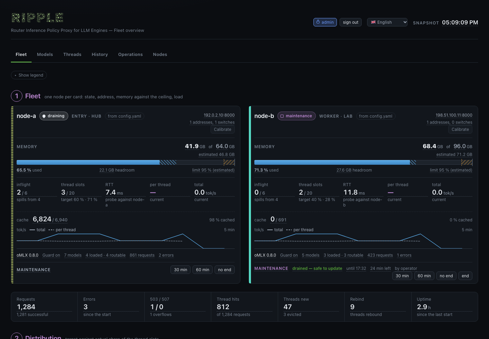

**The legend** at the top names the seven node states — `healthy`, `loading`,
`degraded`, `maintenance`, `down`, and the two an operator can put a node into:
`draining` and `disabled`. The state is carried by colour *and* shape — a filled
circle, a half circle, a filled triangle, an open square, a white droplet, a
cross and a grey hollow triangle — one shape per state, so it survives greyscale
and red-green colour blindness. The last two are the operator's: `draining` is a
white drop, because the node is still there and only running out; `disabled` is
the outline of the `degraded` triangle in grey, because it is the same node,
only switched off deliberately and with a way back.

**One card per node.** Reading a card from the top:

- the **name**, the **state chip**, `role · site` — `ENTRY · HUB` on node-a,
  `WORKER · LAB` on node-b — and the **origin chip**, `from config.yaml` or
  `added at the page` (see below);
- the **address in use** (not the first one in the file: the one that actually
  answered), how many addresses are configured, and how often the node has
  switched between them;
- the **memory bar** — see below;
- a **loading line** while a model is being loaded, with the model, its size and
  an estimate of the remaining time;
- five **metrics** of equal width: `inflight` against `max_inflight` (and the
  threshold from which new threads spill to another node), `thread slots` against
  `max_threads` — with the node's target share and its **relative load** on the
  second line of that cell, the number the optimizer decides on (§4.3) — `RTT` in
  milliseconds, `tok/s per thread` and `tok/s total`, both read from the same
  bucket of the series below and both carrying the age of that bucket, and
  `cache` as a full-width row beneath them: the prompt tokens the last request
  found in the cache against that request's prompt, with the share that was
  cached, and the sample count and the last request's prefill and decode rates in
  the tooltip;
- a **footer** with the node's oMLX version — the only value there in the full
  foreground tone, because it is the one that says which build the node runs —
  whether the eviction guard is on, how many models it offers, how many of those
  are loaded and routable, and its request and error counters;
- the **maintenance row** — the three window buttons, disabled until the page is
  unlocked.

**The tok/s series** under the metrics is the node's decode rate over the window
named at its right edge, as two lines: `total` solid, `per thread` dashed. The
plot is 46 px high and carries no y-axis — a scale there would be smaller than
its label — so the pointer does the reading. Its zero is the card's separator
line directly below: the plot has no padding of its own, so a rate of 0 sits on
that rule instead of floating 9 px above it, and the two lines cannot be read as
two scales. The two rate cells above show the last bucket of the same series. The
pointer snaps to the bucket under it, draws a 1-px crosshair at that x, and the
two legend marks at the top keep their pattern and take the two numbers of that
bucket, one per line; only the card under the pointer shows a readout, the others
keep their legend. The probe runs every
10 s into 5-s buckets, so every second bucket is empty by construction and the
line draws across it: a bucket without a sample of its own reads as the value of
the segment that crosses it, marked with a leading `~`, and only a run of two
empty buckets — a lost tick, an absent node — reads `—`, exactly where the line
breaks. A finger has nothing to hover, so there the block's `aria-label` carries
the last value of both lines instead. A node without samples keeps its frame and
says `no samples yet` in the area, so the card does not change height.

**The KPI strip** under the cards counts for the whole fleet: requests (and how
many succeeded), errors, `503 / 507`, thread hits as a share of all requests, new
threads (and how many had to be evicted to make room), rebinds — the moves the
optimizer made (§4) — and uptime.

**Distribution** answers the question the weights are for: per model, one block
with one row per node, showing the target share, the actual share, and the
difference. The actual share is measured in one of two keys, and the column
header says which one is in force. A model that holds conversation slots is
measured in **thread share**. A model that holds none — an embedding or a
reranker by design, or a chat model with no bound thread in the window — is
measured in **request share**: its requests in the same 900 s window
(`hosts[].requests_by_model`), because 0 of 0 slots is not a measurement.
The target share stays the weight's quotient in both cases, so the difference
still means what it says: the weights ask for 60/40, the traffic may run 75/25.
The note underneath gives each node's request count and its share of all
requests.

**What earns a row.** A model is listed when it holds a thread, or served a
request in the 900 s window, or is loaded and routable on at least one node —
`loaded && dispatch` on that node's entry. The third case is why a resident
model keeps its block while it is idle: 0 slots, 0 requests, `—` for the actual
share and the difference, and `no warm thread` where the bar would be. A
slotless model that did serve requests keeps its block on the request key
instead, so its bar and its difference are real numbers. Entries oMLX keeps for
itself (`dispatch: false`) and models that are not loaded get no row at all. A
node row inside a block follows the same rule from the other side: it appears
when the node would dispatch the model, or held a thread or a request there.

**Load per host** is the ledger: five *exclusive* states per node — idle,
loading, prefill, mixed, decode — drawn as one bar whose width is the sampled
time, plus the work behind it (requests, prompt and completion tokens in
millions). Under it, the nodes' own count from their SQLite database as a
cross-check; the gap between the two is traffic that went past RIPPLE. The sum
row at the bottom is set off by a 1-px axis across the full row width, 9 px above
it and 11 px below the row above — not by a frame: a ring in a neutral grey
groups with the segments instead of separating from them, while the hairline sits
in the gap and costs no layout. The row itself is one lightness step brighter
than the bars it sums, not taller: a taller bar would be the only tall element in
the block and would take the first glance away from the nodes. `Reset` zeroes the
ledger and needs the admin key.

#### The two memory numbers

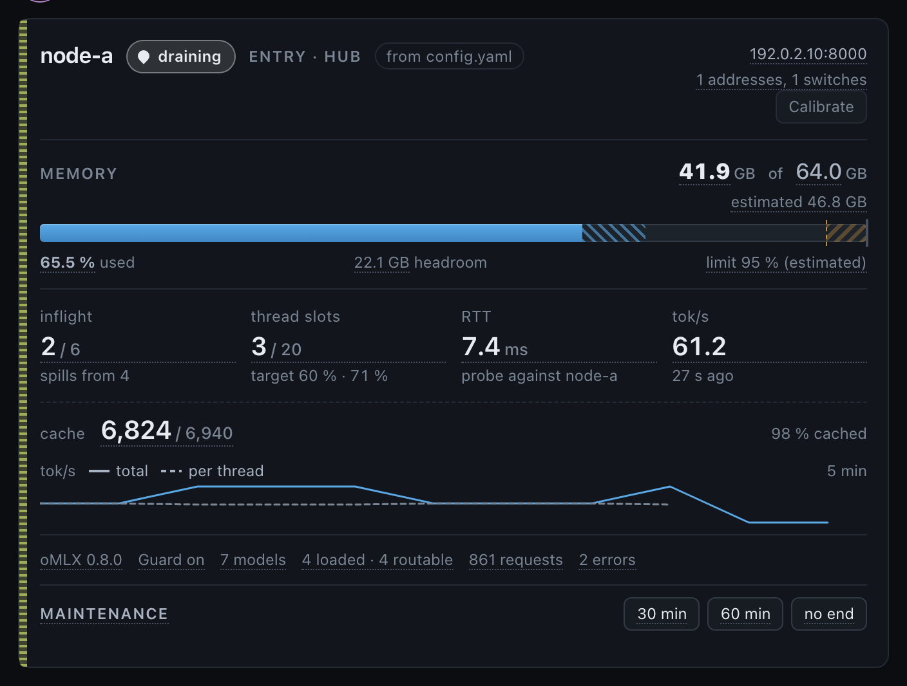

The card shows **two** memory sizes, and they are never mixed:

- the big number — `41.9 GB of 64.0 GB`, `65.5 % used`, `22.1 GB headroom` — is
  `used_bytes_measured`: the sum of what each resident model reports as its
  `actual_size` after loading. A profile of a model (`X:agent`, `X:think-1m`)
  counts once, on its source model: oMLX repeats the source's size on the
  profile's row, so adding the row would charge one engine several times. It is
  the only number that was **measured**.
- the line underneath — `estimated 46.8 GB` — is `used_bytes`: oMLX's own
  estimate for the resident weights (`engine_pool.current_model_memory`). It is
  what the eviction guard, admission and placement decide on, which is why it
  stays visible next to the measurement instead of being hidden.

The bar draws both: the solid part is the measured size, the hatched part is the
difference up to the estimate, and the marker at 95 % is the admission target
(`hard_threshold`). When the estimate crosses that marker, the bar turns and the
guard starts refusing new work — even though the measured number may still look
comfortable. That is not a bug: the guard has to decide before the machine runs
out, and the estimate is the conservative side.

#### `ENTRY`, `WORKER`, and the location

`ENTRY` and `WORKER` are the node's role, written as documentation next to the
state. `ENTRY` marks the machine RIPPLE treats as its primary node — the one it
asks when no node's model list could be read at all; `WORKER` marks the others.
The role does not change how work is split: the **weight** does that (`3` and `2`
mean a 60 % / 40 % target for new conversations).

The part after the dot is the **site** — the location the machine stands in
(`hub`, `lab`), as declared in the `sites:` block of the configuration. Routing
does not read it. What does read it is `ripple doctor` and this card: if the
address a node is actually reached through does not lie inside the declared
site's networks, the card shows a warning naming both. That is how a machine that
was moved — or reached over a bridge that hands out a different network — becomes
visible instead of silently claimed.

#### `from config.yaml` and `added at the page`

The chip after `role · site` answers a question that is easy to get wrong a week
later: **where does this node come from?** There are two sources, and they behave
differently on purpose.

- `from config.yaml` — the machine is written in the file by hand. That file is
  the baseline: RIPPLE reads it, never writes back into it, and a click on the
  page must not be able to make a hand-written machine disappear. Such a node can
  be **disabled**, never removed; the `Remove` button in the Nodes tab is off for
  it and its tooltip says `declared in config.yaml — disable it instead`.
- `added at the page` — the machine lives in the **runtime overlay**,
  `~/.ripple/fleet.yaml`, which the Nodes tab writes (§5.6). It exists nowhere
  else, so it can be removed again, and the overlay is merged over the
  configuration at start-up.

A node that is in both keeps the **machine's** description from `config.yaml` —
addresses, `node_id`, backend, key — and takes only the **operator's** decisions
from the overlay: `enabled`, `weight` and `site`. That asymmetry is the whole
point of the rule: an address or a `node_id` is a fact about a machine, and a
second copy of it in a file the page writes would be a second truth. If you want
a different address, edit `config.yaml`; if you want a different weight, a
different site or the node switched off, the page is the right place and the
change survives a restart.

The chip is also the fastest way to find the node you added yesterday and forgot
about: the overlay is a file of its own, and a node in it has no line in
`config.yaml` to look at.

#### `draining` and `disabled`

Two states exist that oMLX knows nothing about; both are RIPPLE's own, and both
are reversible.

- **`draining`** — the node is on its way out. It accepts no new work, the
  requests it has already accepted finish, and the state lasts exactly as long as
  something is still in flight. It is not a window with a duration: it ends when
  the last request ends. The maintenance row on the card says the same thing in
  words, `draining (n)`, and turns into `drained — safe to update` when `n`
  reaches zero.
- **`disabled`** — the node is out of the fleet until someone puts it back. It
  keeps its name, its place on the page and its slot account, but nothing is
  dispatched to it, its share of new threads is `0 %` (the weight stays as the
  wish for the day it comes back), and its models do not count towards the
  fleet's capacity. A disabled node is not a removed node: nothing was forgotten,
  and `POST /admin/nodes/{name}/disable` is undone by enabling it again.

Neither state changes anything on the machine. A node in maintenance, a node that
is draining and a node that is disabled all keep running their oMLX exactly as
before — what changes is only whether RIPPLE sends work there.

#### Where the numbers come from

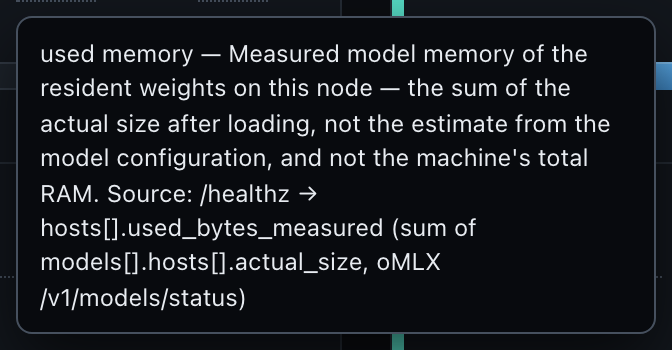

Every number on the page has a tooltip, and every tooltip ends with its source.
Hover any value and you get the definition plus the exact field it was read from —
`/healthz → hosts[].used_bytes_measured`, `/stats → by_host[].requests`, and so
on. Two consequences are worth knowing:

- you can always tell a **measurement** from an **estimate**, and a number RIPPLE
  counted from one a node reported;
- when a number looks wrong, the tooltip tells you which endpoint to `curl`
  before you believe the page.

The numbers on the page are read-only: it fetches `/healthz`, `/stats` and
`/config` every two seconds and patches the DOM, and no displayed value is edited
in place. A **parameter** you want different is edited in `config.yaml` and needs a
restart, because a weight that changed under a running conversation would move it
away from its cache. What the page *can* change is operator state — a maintenance
window, the model policy, the padlock, a calibration, a replication, the key list,
a node — and only with the admin key (entered once on `/keys`); every such block
says what it writes before it writes it (§5.6, §6).

### 5.2 The Models tab

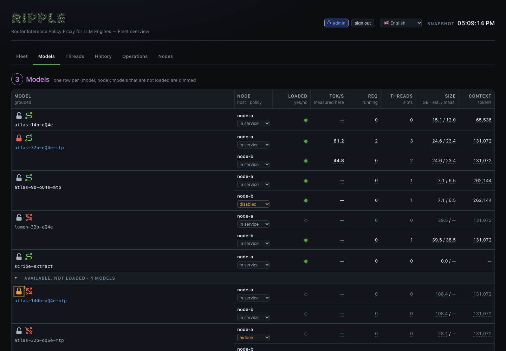

One row per **(model, node)** pair — the same model appears once for every node
that offers it. The columns:

| Column | Meaning |
|---|---|
| **Model** | The model id, spanning its rows. A padlock sits above it (§5.2.1); a struck-through route (`route-off`) appears when that node cannot serve the model **right now** — hovering or tapping it names the reason: either RIPPLE would not dispatch to it at all, or the model is listed but not loaded, so the first request would pay a cold load. A **type chip** on the model row says what the model is — `llm`, `embedding`, `reranker` — in the node's own word. There is no chip when no node labelled it; the value is `""`, not a guess at `llm`. |
| **Node** | The node, and the model policy field (`in service` / `disabled` / `hidden`). |
| **Loaded** | A filled dot when the model is resident on that node. It blinks orange during prefill and green while tokens stream, so you can see what a node is doing *now* without reading the log. |
| **tok/s** | The rate oMLX reports for *this model on this node*, smoothed by RIPPLE — and a dash until the first request has measured one. The calibrated capacity from `config.yaml` is a property of the *machine*, not of the model, so it lives in the tooltip (labelled as such) and never in the cell. A falling number under parallel load is normal; "not measured yet" and "measured zero" are different facts and look different. This is the one column that changes second by second, which is why it stands right after *Loaded* and is the only column set in bold. |
| **Req** | Requests in flight for *this model on this node*, not for the node as a whole. |
| **Threads** | Conversation slots this model holds on this node. A utility model (`embedding` or `reranker`) holds none, so the cell is `—`, not `0`: `0` would read as "no thread right now", `—` says the model has no conversation slot by design. |
| **Size** | `estimated / measured` in GB, per node — the same two bases as the memory bar. |
| **Context** | The model's context window in tokens. |

The four live numbers come first, the two static ones last: read left to right,
a row says what is running, how fast, how much, and how big.

Models that are not loaded anywhere are dimmed and collapsed behind one row
(`available, not loaded · n models`), because they cost disk, not memory. The
list is fed by `/healthz`, so a model that no node currently offers has no row —
and a policy rule for such a model is listed in the Operations tab instead (§6.2).

**Four things this tab says at once, and they are not the same thing.** Whether a
node *may* serve a model (its allow-list, `hosts[].models` in `config.yaml`),
whether RIPPLE *routes* to it there (the policy field, §6.2), whether it may be
*unloaded* (the padlock), and whether the weights are *resident now* (the dot).
The table shows each of them in its own column, and none of them implies another.
The full matrix is in `docs/model-policy.md` (*The four statements about a
model*); the two you operate from this tab are the padlock and the policy field.
The type chip is not a fifth statement in that list: it says what kind of work
the model does, not what may happen to it.

#### 5.2.1 The padlock

One padlock per **model** row, in the Model column, never one per node row: the
lock belongs to the model, not to a machine, so a second icon next to a node would
claim a per-node lock that does not exist (`ripple/static/dashboard.js:1553`).

| what you see | what it means | what to do |
|---|---|---|
| padlock **open**, grey | the model is not protected: RIPPLE may unload it when another request needs the memory | click it to lock |
| padlock **closed**, red, model name in the load tone | locked, and the memory is protected wherever the model is resident | hover for the sentence: which nodes hold it, or that it refuses nothing |
| padlock **closed** and the row is collapsed under `available, not loaded` | `locked, not resident` — the promise is set but nothing is resident to protect | nothing; the model is loaded at the next start or maintenance-window end (§5.2.2) |
| padlock **closed**, dashed outline, `!` in the body | `locked, cannot be resident` — the lock is stored, but no node could hold the model right now: not enough memory anywhere, or every node that lists it refuses it | hover for the numbers: the tooltip names the node and the reason. Then unlock what blocks the model, or lock it on a node where it fits |
| padlock closed, tooltip "not loaded anywhere right now — the lock refuses nothing" while the model **is** loaded on a node | the model is locked but no node would route to it — `disabled` there, or outside that node's allow-list. Nothing can be refused on its behalf | read the policy field next to it: this lock costs memory and protects nothing |
| padlock closed, greyed out, its own tooltip, no policy field | an oMLX **builtin** (MarkItDown): resident without weights, routed to by nothing, always locked and never releasable | nothing — the lock is derived from what the node reports, not from a setting |

The third state is **not** a refusal. The lock is written as before; it just
cannot be paid right now, and RIPPLE says so instead of pretending the promise is
in force. The padlock stays closed — the lock is set, that is not in doubt — but
its outline is dashed and a `!` sits in the body, so the warning is not carried by
colour alone. The tooltip names the node and the reason with the numbers
(`lock.warn_tip`): how many GB the model needs against how many are free, or which
locked model would have to be evicted to make room. Nothing is evicted, unlocked
or re-pinned on its own to resolve it. The answer to the click says `lock saved`
and adds that the model cannot be resident anywhere (`lock.warn_saved`), so you
know the write landed and what it is worth. The feasibility is the preload's own
forecast (§5.2.2) — one calculation, not a second one — so the warning and a
failed preload cannot tell different stories. What is left for you: unlock what
blocks the model, or lock it on a node where it fits.

Open is deliberately **not** green: an unlocked model is the unprotected state,
not a good one, and green would read as "all well" (`ripple/static/dashboard.css:558`).
Without the admin key the padlock is visible but does nothing — the tooltip says
so, because the reason is more useful than a dead control.

A lock is a statement about the model, so it can be set on a model that is cold,
on one a node does not currently list, and on one that no node routes to
(`ripple/proxy.py:1852`). The one thing that cannot be locked is a builtin: it
always is, and the write answers `409 lock_builtin`.

#### 5.2.2 `locked, not resident`, and the preload

A lock promises residency, so RIPPLE delivers it: a locked or pinned model is
loaded as soon as one of its nodes becomes healthy — at start-up, when a node
comes back, and at the end of a maintenance window — on every node whose
allow-list contains it (the preload pass in `ripple/hosts.py`). You will see
three things while this happens:

* the node card shows the ordinary loading line with `source: preload` and a
  remaining time, as for a load a request caused;
* if the load displaces an idle unlocked model, the Fleet tab says `preload of …
  displaced …`, and the displaced model carries `▼ evicted by the preload of …`
  in its node cell. That eviction is intended: the lock wins. A model that is
  **serving a request** is never displaced; the preload refuses with `… is
  serving a request` and waits for the next healthy transition;
* if the model does not fit at all, the Fleet tab says `preload of … failed: does
  not fit: … GB needed, … GB free; … is locked and cannot be evicted` — or names
  a pinned model, or one that is serving. It is not retried — the next attempt is
  the next time the node becomes healthy.

That third bullet's forecast is the same one the padlock quotes (§5.2.1): if the
preload would fail, the padlock says so before you click, with the same numbers.

Locking a cold model does **not** load it on the spot. That is deliberate: the
click must not start a 400 GB load in the middle of the afternoon. The promise is
paid at the next healthy transition or at the next restart. A model pinned in
oMLX is preloaded by the same pass, without a lock: the pin is oMLX's own "keep
it resident", and RIPPLE reads it from the node's model list.

#### 5.2.3 Two intents, two places

"The model must not be routed" and "the model must not be on this machine" are
different wishes and they belong in different places. Writing both into one field
is how a model later goes missing with nobody able to say why:

| you mean | where it goes | what you see afterwards |
|---|---|---|
| it is on this node's disk and I do not want it routed | the node's allow-list, `hosts[].models` in `config.yaml` (`ripple/config.py:165`) | the model still appears on the node as offered, no request goes there, and the change is one line you can take back |
| it should not exist on this machine at all | oMLX — remove it from the model directory | the node stops listing it; RIPPLE has no route that deletes weights and will only observe the result |

The allow-list is per host, visible in the config and reversible; deleting from
oMLX is neither. RIPPLE's own two write routes touch only
`~/.ripple/models.yaml` (`ripple/proxy.py:1884`, `ripple/proxy.py:1919`), so
nothing you do on this page can move a model off a disk — and nothing you do in
oMLX can quietly change a routing rule.

### 5.3 The Threads tab

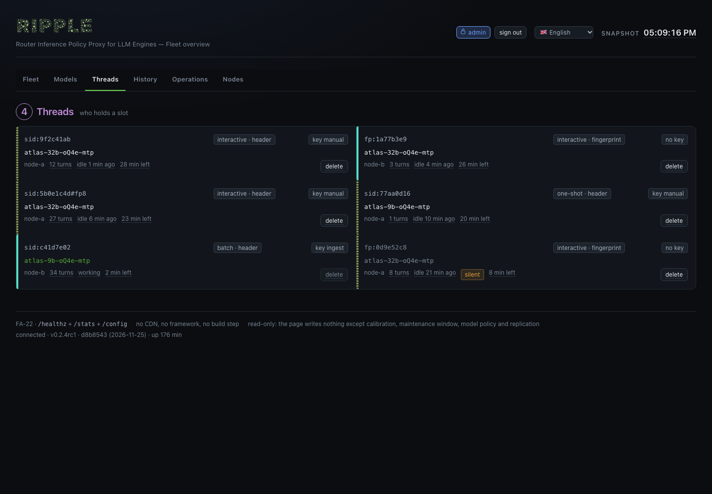

The unit of placement is the **thread** — one conversation — not the request. A
thread is what holds a slot on a node and keeps the prefix cache warm; the tab is
the registry of them. Above 1100 px the list stands in two columns; below that it
is one, because at 1100 px the key still has 205 px and at 1060 px three of four
keys truncate. One line per thread:

- the **key** — `sid:…` when the client sent `X-Session-Id`, `fp:…` when RIPPLE
  recognised the conversation from its first message;
- `kind · source` — `interactive`, `batch` or `one-shot`, and whether the id is
  the client's or a fingerprint;
- the **client key** the thread arrived with, or `no key` when the caller had
  none (loopback, or authentication switched off);
- the **model** — in green while a request is running on this thread;
- the **host** it is bound to, its **turn count**, and either `working` or how
  long it has been idle;
- the **remaining time** until the slot is released — 30 minutes by default,
  counted down every second;
- a **delete** button that gives the slot back immediately instead of waiting for
  the countdown.

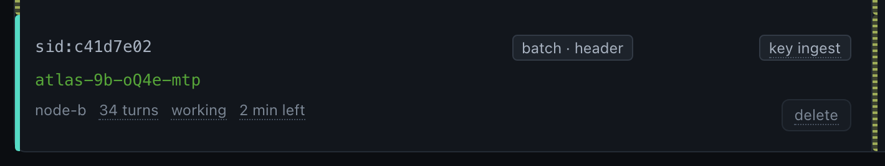

The line above shows a thread with a request in flight: the model name is green,
and `delete` is off — pulling the slot out from under a running request is exactly
what the reservation exists to prevent. Deleting an idle thread costs at most a
re-prefill if the conversation comes back.

### 5.4 The History tab

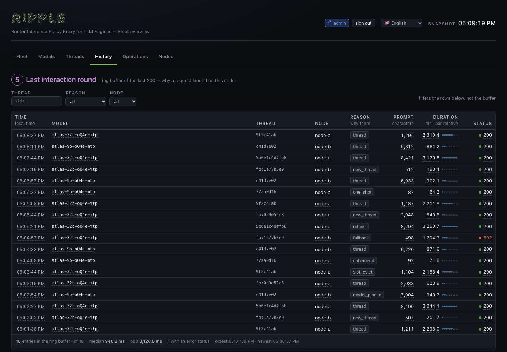

The last 200 routing decisions, newest first — one line per request, and the
answer to "why did *that* one go *there*". Eight columns: the time (local), the
model, the **thread** key, the node, the **reason** (a token, see the table
below), the prompt length in characters, the duration in milliseconds with a bar
relative to the longest row on screen, and the status, with a dot that is green,
amber from 400 and red from 500.

**The thread column** is the short form of the key the decision was taken for:
`sid:` comes off, the family marker stays whole (`gwk_`, `local-`), the id is cut
to eight characters, and a `#<fp8>` suffix survives untouched, because it is what
tells two work units of one conversation apart; a key without a marker is cut to
twelve. The full key is in the cell's `title` and in its tooltip; `—` stands for a
request that held no thread.

**Three filters** sit above the table and narrow the rows, not the buffer. `sid`
is a substring of the raw key, case-insensitive — `gwk` and `sid:gwk` both work.
`reason` and `host` are exact, and both are dropdowns filled from the values the
buffer actually holds, sorted, with `all` first. A value that leaves the buffer
while it is selected stays in its dropdown as an option of its own, so the select
keeps saying which filter is in force; an empty result keeps the head, one row
saying so and the footer, so the panel does not jump on every keystroke.

The footer describes the rows that survived the filter, not the buffer: how many
they are — labelled `entries in the ring buffer`, which is the same thing only
while no filter is set — with the buffer's total behind them as `of 200`, the
median and the 90th percentile of their durations, how many ended with an error
status, and the oldest and the newest of them, in that order.

The reason is a token and the chip carries it unchanged; the tooltip repeats the
same sentence from the page's catalog (`reason.<token>`). The table names the
twenty-five tokens that can stand in that column, in the order an operator meets
them: why the request is here, why a thread moved or did not, why it failed, why
it landed on the second-best node. The catalog translates twenty-one of them;
`resident`, `cold_load`, `evict_idle` and `model_locked` have no entry yet and
appear as bare tokens.

| Reason | What it means |
|---|---|
| `thread` | This conversation already has a thread on this node — the prefix cache stays valid, nothing is reloaded. |
| `new_thread` | A new conversation; the node was chosen by current load and residency. |
| `one_shot` | A request that deliberately holds no thread — slots and slot eviction do not apply to it. |
| `ephemeral` | A short one-off request: no slot, no cache, only load decides. |
| `moved` | The thread was moved: the prefill pays for itself over the turns that remain. |
| `rebind` | The sweep moved the thread to smooth the distribution. |
| `no_repayment` | The prefill would cost more than the remaining turns save. |
| `cost_exceeds_ttl` | The prefill would take longer than the thread's slot has left. |
| `gain_below_band` | The gain clears the cost but not the cost times the safety factor plus the measured noise band. |
| `cooldown` | The thread moved recently; a move back inside the cooldown is priced higher. |
| `pinned` | The conversation has spent its moves inside the window. |
| `budget` | The fleet's hourly move budget is spent. |
| `fallback` | The first node failed; the request was retried on the other one. |
| `no_candidate` | No further node left for a retry. |
| `no_healthy_host` | No healthy node offers this model. |
| `unknown_model` | No node knows this model. |
| `model_list_unavailable` | A node's model list could not be read, so whether it carries the model is unknown — usually its admin key. |
| `slot_evict` | All slots were held by idle threads — the oldest gave up its place. |
| `cold_load` | The model had to be loaded on this node before it could answer. |
| `evict_idle` | An idle model was unloaded to make room, then this model was loaded. |
| `resident` | The model was already loaded on this node. |
| `conflict` | No node could take the request without evicting a running thread. |
| `model_locked` | A model the operator locked would have been evicted; the request was refused with 503 instead. |
| `model_pinned` | Only this node offers the model, so the request had to land here. Not the same as a *locked* model — a locked model produces a 503 `model_locked`, not this token. |
| `degraded_host` | The preferred node was degraded; the request went to the healthy one. |

Three further tokens the catalog does not translate can stand in the column: the
refusals the operator caused — `model_disabled`, `model_hidden` — and a bare
`error` when no decision was reached. Their explanation is the request's error
message, which names the node, the level and the endpoint that undoes it.

### 5.5 The Operations tab

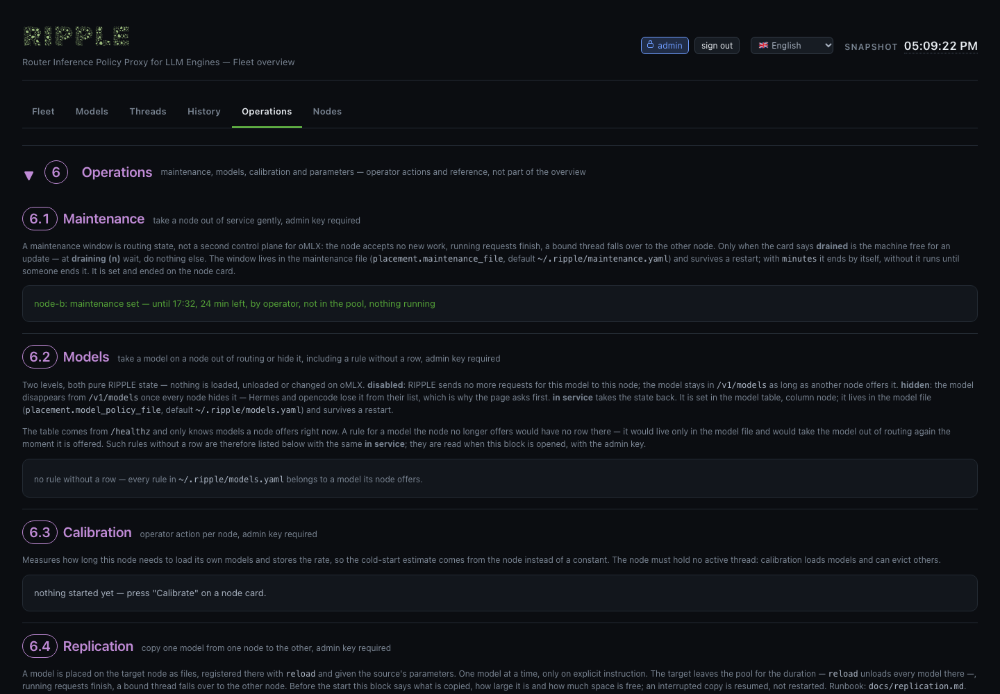

Six blocks, all behind the admin key, all of them routing state rather than a
second control plane. The first four are described one by one in chapter 6; the
last two show the configuration in force and the one action that needs it:

- **6.5 Parameters** — the configuration actually in force, one row per setting,
  read from `/config`. This is the page that answers "which value is it really
  using?" — defaults applied, `${VAR}` expanded, secrets reduced to `set` or
  `none`. Each row shows the value in effect, where it comes from
  (`config.yaml` or *set at the page*) and a reset control once it has been set
  at the page. **Routing policy can be set here**: a host's weight, spill
  threshold and residency preference, the thread lifetimes and the match
  threshold, the rebind bounds, the balance hysteresis. Those values live in
  `~/.ripple/fleet.yaml`, an overlay over `config.yaml`, and they survive a
  restart — `config.yaml` is never rewritten. The same block carries each host's
  utility budget: `hosts[].max_inflight_utility` is the hard cap for embeddings
  and reranks alone, separate from `max_inflight`, so a bulk ingest fills its
  own budget instead of the one a conversation waits on. Empty follows
  `max_inflight`; a value above it is refused when the file is loaded, and the
  row shows the number in effect, never `null`. A weight change asks first: it
  applies to new threads only, and the question names how many running threads
  keep their host until they end, because a weight that shifts under a running
  thread pulls the conversation away from its prefix cache. **Identity,
  transport and limits cannot be set here**: `listen`, the log level and file,
  the session header and every identity field of a host are restart-bound, so the
  row shows that reason instead of an input rather than pretending a field could
  do it. One row is worth reading twice:
  `default_pp_tps: 0` under `placement.rebind` does **not** mean *infinitely
  fast*. 0 means *not measured* — it prices no move — so a node without a
  `pp_tps` of its own is never a rebind destination, and when that leaves the
  fleet with no destination at all, rebinding is on and cannot fire. The page
  shows the rate per node for exactly that reason (`not measured — no rebind
  target`), and `ripple doctor` reports the fleet-wide case (§3.2).

  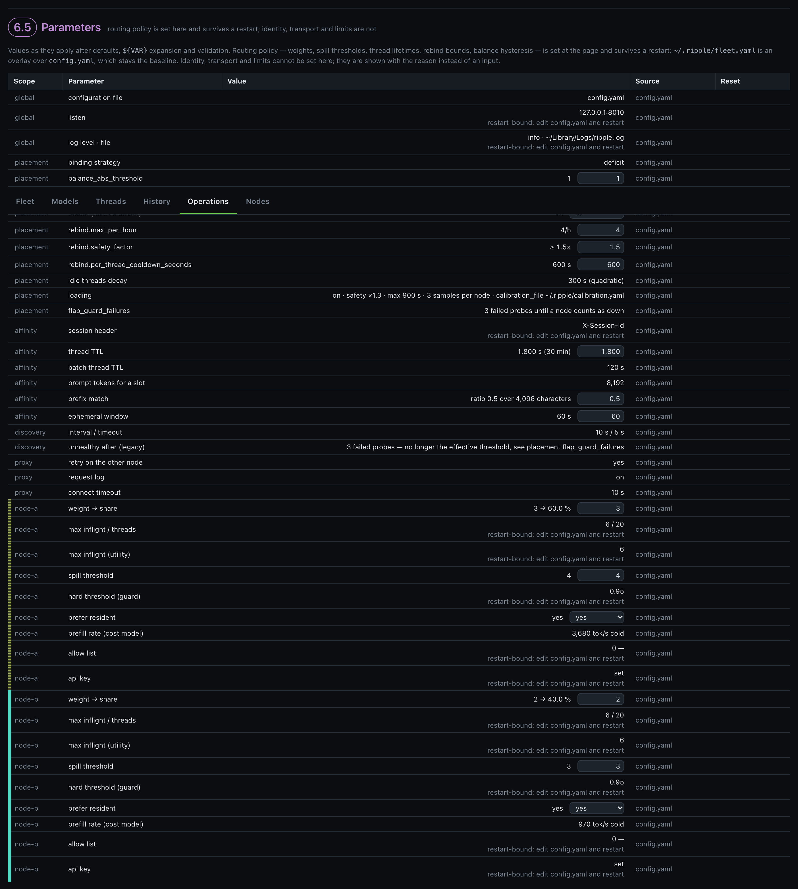

  The 6 px stripe in the scope column is a node: `global`, `placement`,
  `affinity`, `discovery` and `proxy` rows carry an empty slot of the same width,
  so every label starts on the same line — the stripe marks a value that belongs
  to one machine, not to the fleet.

  Every parameter name carries its own explanation: hover it, or tap it on a
  phone, and the sentence says what the setting does and what a change costs. The
  sentence is not written in the page — it sits next to the field in the config
  schema (`FIELD_HELP` in `ripple/config.py`), is served as `help` by
  `GET /config`, and a test holds every path that may be set at the page to an
  entry, so a new parameter cannot arrive without one. Four rows stay
  without a tooltip because they are not settings: the path of the configuration
  file, the `loading` line that sums four settings, and the two measured prefill
  rates.
- **6.6 Restart** — see §6.5.

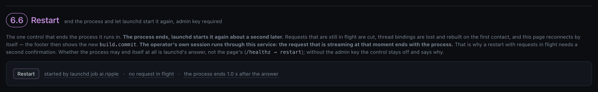

### 5.6 The Nodes tab

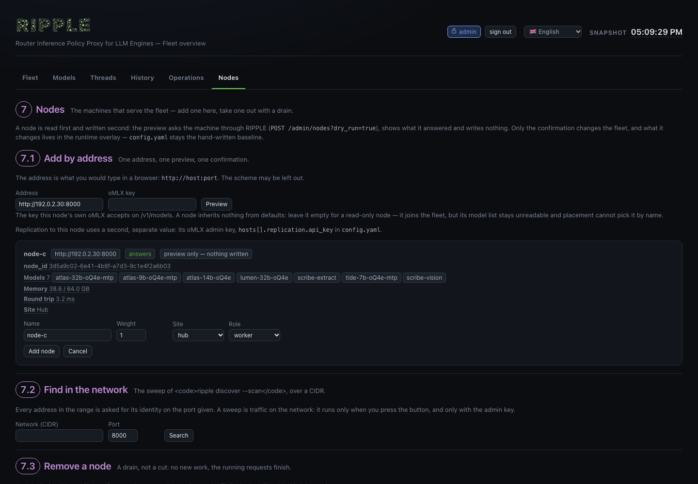

The sixth tab (the page numbers it `7`) is the only place where the **fleet
itself** changes. Everything else on the page acts on a node that is already in
the fleet: it puts it into maintenance, switches a model off on it, calibrates
it, copies a model onto it. This tab adds a machine to the fleet or takes one
out of it.

That is also why adding a node is not a maintenance step, although the two look
alike at a glance:

- maintenance assumes the machine is **already in the fleet**, and that its name
  is already the key for its thread slots, its affinity and every log line that
  mentions it. When you add a node, that name does not exist yet — there is
  nothing to put into maintenance.
- adding a node changes the **arithmetic of the whole fleet**: its weight enters
  the total, so every other node's target share drops. Maintenance changes
  nothing about the shares; it removes one machine from the pool for a while.
- the input is not a number the page already knows, but an **address that has to
  be read first**. Reading it is a step of its own, and it is the step that
  decides whether the rest happens at all.

The tab has three blocks — `7.1` add by address, `7.2` find in the network,
`7.3` remove a node — and all three are behind the admin key.

#### 5.6.1 Add by address

**What it does.** Two steps, and the order is the point: *read, then write*.
`Preview` sends `POST /admin/nodes?dry_run=true` with the address **and the
node's own oMLX key**, if you entered one. The proxy resolves the address, asks
the machine for its identity and its model list, measures the round trip and
derives the site the address falls into. **Nothing is written** — not the fleet,
not `config.yaml`, not the overlay.

**The key field belongs to the node, not to the fleet.** A node is a standalone
machine and inherits nothing from `defaults`, so the key the page asks for here is
the one *that* machine's oMLX accepts on `/v1/models` — the same key `ripple init`
took for the first node, and the one that sits in `~/.omlx/api_key.txt` on the
node. Without it the probe answers 401 and the node arrives with no models at
all: no residency, no placement by name, and the whole fleet loses the model
intersection (FA-18). Leaving the field empty stays a valid answer and means a
**read-only node**: the preview says `no key — read-only node`, the confirmation
repeats it, and the add answers *added read-only* with the reason instead of a
bare "0 models". That is the right choice for a node you only want to see, not to
route to.

**What the preview shows.** Four measured facts and one derived one:

| Field | What it is |
|---|---|
| `node_id` | The identity the machine reports about itself. It is what makes a node a node and not an address: the same machine reached through another address is recognised by it, and a second declaration of it is refused instead of becoming a second slot account. |
| **Models** | What the node offers, the first twelve by name and the count. `model list unreadable` is not a refusal: the node answered, but its list could not be read — usually because the key is missing or wrong for *this* node. The add still works; placement just cannot use the node by model name until the list is readable. |
| **Memory** | `used / ceiling` in GB, as the machine reports it. |
| **Round trip** | The measured latency of the probe, in milliseconds. |
| **Site** | The location the address derives into, e.g. `Hub`. A location, not a routing rule: a node outside every declared site can still be added, and the preview says so instead of refusing. |

**What it does not do.** It does not write, not even a placeholder: if you close
the tab after a preview, nothing has happened anywhere. It does not reserve the
node, does not touch its oMLX, does not change a target share and does not make
the machine part of the fleet. It also does not decide the name: the four fields
under the preview — name, weight, site, role — are **your** decisions, pre-filled
with the measured defaults (the name the node reports, weight `1`, the derived
site, role `worker`). Only the confirmation writes them.

**The confirmation.** `Add node` asks once, naming exactly what it is about to
do — `Add node-c (http://192.0.2.30:8000) to the fleet? weight 1 · site hub ·
role worker` — and then writes. The node lands in the overlay
(`~/.ripple/fleet.yaml`), appears on the fleet card with `added at the page`
(§5.1), and from that moment takes part in placement like any other node. Its
weight enters the total, so the other nodes' target shares drop accordingly.

**What can go wrong.** The preview names the step that failed, and keeps the
server's own sentence as a tooltip:

- *The address did not answer* — wrong address, wrong port, or nothing listening
  (`step: resolve`).
- *Something answered, but not this node* — the address belongs to a machine
  whose identity contradicts what the fleet already knows (`step: node_id`). This
  is the check that catches a reused address: an IP that once belonged to
  `node-a` and now answers as something else must not silently inherit its slot
  account.
- *The node answered; its model list could not be read* — the add is possible,
  but placement cannot use it by name yet (`step: models`).
- *The admin key was refused* — the tab still holds the previous key, usually
  because `ripple init --force` rotated `auth.admin_key` in the meantime
  (`step: admin`, `code: admin_key_refused`). The sentence says where the current
  key is: `config.yaml`, `auth.admin_key`.
- A node that is already in the fleet is refused as a duplicate, whether it was
  matched by address or by `node_id`.

#### 5.6.2 Find in the network

`7.2` is the sweep of `ripple discover --scan`, over a CIDR and a port. It asks
every address in the range for its identity and lists what answered: address,
name, `node_id`, model count, latency, derived site. A candidate that is already
in the fleet is marked (`already in the fleet: node-a`) and its `Preview` button
is off — two declarations of one machine would be two slot accounts for it.

`Preview` on a candidate is not a second way to add: it fills the address field
and runs the same preview as `7.1`, so there is exactly one path into the fleet.

A sweep is **traffic on the network**: it runs only when you press the button,
only with the admin key, and only over the range you name. A `/24` is 254
probes; this is not a background job that keeps scanning.

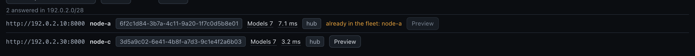

#### 5.6.3 Removing a node, and the drain

The list at the bottom is the fleet as the page knows it: name, state, address,
origin, `inflight`, and a `Remove` button. The button is off for a node that
`config.yaml` declares — the file is the baseline (§5.1) — and off while a drain
is running on that node.

`Remove` opens the **drain dialog**, not a yes/no question. It names what is
still running:

- `2 request(s) in flight`, or `nothing in flight`;
- which models those requests are on (`DeepSeek-V4.1-Flash-1017-oQ4e-mtp ×2`),
  read from RIPPLE's own bookkeeping (`/healthz → models[].hosts[].inflight`), so
  asking costs the node nothing;
- the deadline: `waits up to 120 s for them` — `fleet.drain_seconds`, 120 seconds
  by default.

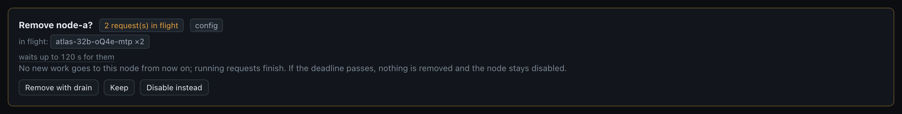

**`Remove with drain`** then does three things in this order: it takes the node
out of the pool at once, so no new work is dispatched to it; it waits until
`inflight` reaches zero, polling up to the deadline; and only then does it delete
the node from the overlay, releasing its thread slots and reporting how long it
waited and how many slots it released. A conversation that was bound to it is a
cold prefill elsewhere on its next request — the drain protects the requests that
are running, not the cache behind them.

**What happens when the deadline passes** — and this is the part worth reading
twice: **nothing is removed.** The call answers `409` with the code
`drain_timeout`, the requests still running and the models they are on; the node
stays in the fleet and in the overlay, but it is **disabled**, so it receives no
new work and cannot be forgotten in a half-removed state. The dialog stays open
with the fresh numbers, and the page prints the sentence that says it plainly:

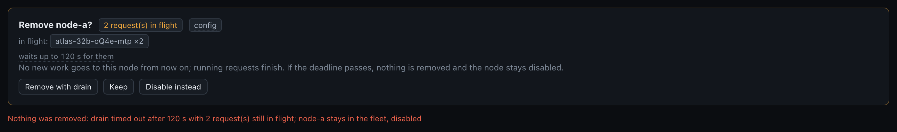

From there the honest options are: wait for the long generation to end and remove
the node again, or accept the state it is in — it is out of the pool, its name and
its counters are still there, and `POST /admin/nodes/{name}/enable` brings it back
with one call (there is no button for that on the page). `Disable instead` in the
dialog is the same decision taken deliberately, without waiting out the clock:
useful when you already know that the request in flight will take longer than the
deadline.

**What it costs.** The fleet's capacity minus one machine, from the moment you
confirm — the same cost as a maintenance window, except that the machine does not
come back by itself. A drain also cannot be undone by pressing `Keep` after a
timeout: by then the node is disabled, and `Keep` only closes the dialog.

## 6. Operating

The six controls below — plus the Nodes tab (§5.6), which changes the fleet
rather than a node inside it — are the only things on the page that change
anything. Each is described as: what it does, what it costs, and what can go
wrong.

The page numbers its Operations blocks 6.1–6.6, with **Parameters** as `6.5`;
that pushes the restart control to `6.6` there, while this chapter has restart as
§6.5 and Keys as §6.6. A reference to `6.6` on the page therefore means the
restart element described in §6.5 here.

### 6.1 Maintenance — take a node out of rotation, gently

**What it does.** Marks a node as `maintenance` for 30 minutes, 60 minutes, or
without an end. From that moment it accepts no new work; running requests finish.
The state is RIPPLE's own (`~/.ripple/maintenance.yaml`), persists across a
restart, and ends by itself when the window expires. The same control ends it
early.

**What it costs.** The whole fleet's capacity minus one machine, for the duration
of the window. Threads bound to that node keep their slot until they are rebound
or expire, so the target share you see will lag behind reality for a while.

**What can go wrong.** A window without an end is easy to forget: the node stays
out of rotation until someone ends it, and nothing turns red — the card says
`maintenance`, which is a state, not an error. Use it when you want to be sure
nothing new arrives (an oMLX update, a reboot), and give it a duration when you
are not sure you will come back to it. The card distinguishes `draining (n)` from
`drained — safe to update`: only the second one means the machine is really idle.
`draining` is the same word and the same fact as in a removal (§5.6.3) — work is
still running — but a maintenance window ends by itself, while a node that has
been removed or disabled does not come back on its own.

### 6.2 Model policy — `disabled` and `hidden`

**What it does.** Switches a **(model, node)** pair off without touching oMLX.
Two levels, and the difference matters to your clients:

| Level | Dispatch to this node | Appears in `/v1/models` |
|---|---|---|
| `disabled` | no | yes — as long as another node still offers the model |
| `hidden` | no | no — once **every** node that offers it hides it |

`hidden` implies `disabled`. Hiding a model but still routing to it would answer a
client that knows the id while telling everyone else the model does not exist.

This `disabled` is the **model's** state on one node, not the node's: a node can
be `disabled` as well (§5.1), and the two are independent — a disabled node takes
its whole model list out of the pool, a disabled model takes one model off one
node.

**What it costs.** `disabled` costs nothing visible: the model stays in the list
and moves to the other node. `hidden` is **client-visible**: Hermes and opencode
lose the model from their lists the moment the last node hides it, and their next
request for it fails as "unknown model". That is why the page asks before it sets
one.

**What can go wrong.** A rule can outlive the model it names — after an allow-list
change or an oMLX update, the node no longer offers it, and the rule would have no
row in the table (the table is fed by `/healthz`). Block **6.2** lists exactly
those rules beside the table and lets you undo them; that is the only place they
are visible. A missing or corrupt policy file means "nothing is switched off" —
the expensive direction is deliberately the one that cannot happen.

**Not to be confused with the lock.** `disabled` and `hidden` decide *where a
model may be routed*; the padlock in the Models tab decides *whether it may be
unloaded* (§5.2.1). The lock is not a policy level and the policy is not a lock:
`disabled` + locked is the drain pattern — stop sending new threads, keep the
model warm — and it is a legitimate combination, not a contradiction. Which of
the four statements you are changing, and what each combination does, is in
`docs/model-policy.md`.

### 6.3 Calibration — measure what a node can do

**What it does.** Loads the node's own models one after another and times how long
each load takes. The samples (model size → seconds) are stored per node in the
calibration file, and the curve through them answers "how long will this load
take" — that is what the loading line on the fleet card shows as remaining time,
and how long RIPPLE keeps its probes off a node that is busy loading. An
uncalibrated node falls back to two measurements taken on a reference machine,
which is why the first estimate on a new node can be visibly off.

**What it costs.** Minutes per node, and memory churn on it: every model is loaded
and unloaded in turn. The node must hold **no active thread** — the `Calibrate`
button is off while any slot on that node is taken, and a locked model that is
resident on it refuses the run entirely, because both would take memory away from
something that is running (`ripple/calibration_api.py:645`).

**What can go wrong.** A calibration on a busy node measures the load, not the
machine: the stored rate is then too low and every estimate afterwards is based on
it. Calibrate when the fleet is quiet, and re-calibrate after a hardware or oMLX
change — the number is a property of the machine and the disk it loads from, and
it does not update itself.

### 6.4 Replication — copy one model to another node

**What it does.** Copies one model's files from one node to the other over SSH,
reloads the target so oMLX sees it, and writes the source's per-model settings
back onto the copy. It writes to another machine's filesystem — every other
write path on the page (calibration, maintenance, model policy, parameters,
restart, the node list) stays on this host.

**What it costs.** The target leaves the pool for the duration of the reload, so
its capacity is gone while it re-reads its model directories. A large model is a
long copy — bounded at six hours by default — and it needs free space of at least
the model's size times 1.05 on the target.

**What can go wrong.** A copy that is interrupted leaves files behind that oMLX
may or may not see; the job reports what it wrote and what it did not. Settings
that cannot be replicated are named rather than silently dropped: three keys are
excluded by design, and any other mismatch — including a value that is `null` on
one side and set on the other — ends in `state: failed` with the differing keys,
never in a green job. The panel asks before it starts and shows the plan (size,
free space, destination path) first. The runbook is
[`replication.md`](replication.md).

### 6.5 Restart — end the process and let the supervisor start it again

**What it does.** Ends the RIPPLE process; `launchd` starts it again about a
second later. The page waits for the service to answer and then shows the new
`build.commit` in the footer, which is how you know the build you deployed is
really the one running.

**What it costs.** Every request in flight is cut — including the one that is
streaming into your own editor, because the operator's session runs through this
same service. Thread bindings are lost and rebuilt on first contact, which means
one cold prefill per active conversation.

**What can go wrong.** With work in flight the control asks a second time and the
endpoint answers `409` with the count and the nodes (`Repeat with force=1 to
restart anyway`); that is the drain warning, enforced. And the process may only
end itself when it is really supervised: if `launchd` does not own the PID, the
control is disabled and says so — a restart there would be a stop. The state
comes from `/healthz → restart`, so the reason is readable before anyone unlocks
the page.

### 6.6 Keys — who may call, and with which models

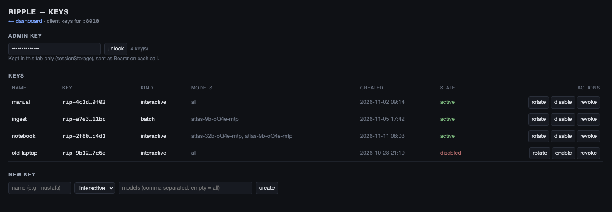

`http://<host>:8010/keys`. The **admin key** (`config.yaml` → `auth.admin_key`) opens
`/admin/*` and this page; `init` printed it once, and here it is only ever masked.
A **client key** is created on this page, opens `/v1/*`, and is shown exactly once.

**What it does.** One row per caller — name, masked secret, kind, model list,
created, state — with `rotate`, `disable`/`enable`, `revoke` and a form for a new
key. The store is `~/.ripple/keys.yaml` (`auth.keys_file`), mode `0600`, written
atomically, so a crash mid-save cannot empty it; an admin key in `config.yaml` wins
over the one in the file.

**The secret appears once**, after `create` and after `rotate`; then only the mask
`rip-L4…HJGx` remains — six and four characters of 36, enough to match a row to a
client, not enough to use it. `rotate` keeps name, kind and models and kills the
old value at once; `disable` keeps row and secret and answers `401` like a wrong
key; `revoke` deletes the row — the answer to a leak, since a disabled row keeps
the secret in the file. An idle key costs nothing; a rotation costs one client
update.

**The model list is per key.** Empty means all; otherwise `/v1/models` lists only
those and anything else answers `404 model_not_found`, not `403` — the model is not
there *for this key*. **The kind** decides what the traffic may occupy:
`interactive` keeps the global TTL (30 min) and a slot; `batch` gets
`affinity.batch_ttl_seconds` (120 s) and gives its slot up first; `one-shot` binds
no thread and takes no slot at all.

**A running thread is not interrupted.** The key is checked per request at the
start (`ripple/proxy.py:2089` → `_authenticate`, `ripple/proxy.py:2497`, disabled
rejected at `ripple/keys.py:394`), never mid-stream; `disable` flips the flag and
saves (`ripple/keys.py:501`) and touches no thread. The request in flight finishes,
its thread keeps the slot until the TTL, and every new request gets `401`; to free
the slot now, delete the thread (§5.3).

**What can go wrong.** The admin key lives in the tab (`sessionStorage`), goes out
as a bearer on every write and never in the URL; five wrong ones a minute per
address earn a `429`. A refused key is reported as a refused key — the notice
names the key and where the current one is (`config.yaml` → `auth.admin_key`), and
a key rotated by `ripple init --force` is the usual cause. A corrupt `keys.yaml`
stops the process at startup instead of starting with zero keys — which looks like
every client losing access at once. And `/keys` itself is open: without the admin
key it shows an empty table.

## 7. Using RIPPLE as a client

### 7.1 The OpenAI-compatible surface

Point the client's base URL at `http://<host>:8010/v1` and its key at a **client
key** (not the admin key). Served paths: `POST /v1/chat/completions`,
`POST /v1/completions`, `POST /v1/embeddings`, `POST /v1/rerank`, and
`GET /v1/models`. Streaming works; there is no read timeout on the proxy, so a
long generation is allowed to finish. Anything that speaks the OpenAI API needs
nothing else, and clients that read `OPENAI_BASE_URL` need not even be
configured.

```bash
curl -s http://192.0.2.10:8010/v1/chat/completions \
  -H "Content-Type: application/json" \
  -H "Authorization: Bearer $RIPPLE_KEY" \
  -H "X-Session-Id: my-conversation" \
  -d '{"model":"DeepSeek-V4.1-Flash-1017-oQ4e-mtp",
       "messages":[{"role":"user","content":"Hello"}],"max_tokens":128}'
```

The key is scoped: it carries a list of models, and `/v1/models` shows a client
only what its key may call. A model outside that list answers `404`, not `403` —
deliberately, so a key cannot be used to enumerate what else exists. Each
`/v1/models` row also carries `type` — such as `llm`, `embedding` or `reranker`,
or `""` when the node did not say — so a client can tell what a model is without
calling it.

**Rerank.** `POST /v1/rerank` speaks the Cohere/Jina shape: `query` (the string
to score against), `documents` (the list of strings), `top_n` (how many results
to return) and `return_documents` (whether the answer repeats the text). RIPPLE
forwards the body unchanged and passes the node's answer back unchanged:

```json
{"results": [{"index": 0, "relevance_score": 0.93,
              "document": {"text": "the first document"}}]}
```

`results` is the node's ranking; `document` is present when the node includes it.
There is no bare `/rerank` alias — a client that defaults to that path changes
its base URL or its path once.

**Utility requests.** An embeddings or rerank call is a utility request: it is
not a conversation. It holds no thread and no conversation slot, so it does not
appear in `threads_new` and does not take a slot a chat request is waiting for;
RIPPLE places it by load and residency alone, and admits it against the host's
utility budget (`hosts[].max_inflight_utility`, §5.5; it follows `max_inflight`
when unset) rather than the chat budget. A model the node labels `embedding` or
`reranker` is utility on any path, so a chat-shaped call to such a model gets the
same treatment. The response carries `x-ripple-reason: utility` and no
`x-ripple-thread`, and `/stats` counts the call in `requests_utility`. Nothing is
registered before the request is forwarded, so a utility call the node rejects
leaves no thread behind.

### 7.2 `X-Session-Id`, and why threads exist

The placement unit is the conversation, not the request. A conversation that keeps
landing on the same node keeps its prefix cache, and a cache hit is the difference
between a request that starts answering immediately and one that re-prefills tens
of thousands of tokens. Utility calls — embeddings and reranks — are the
exception: they have no conversation and hold no slot (§7.1).

Send `X-Session-Id` — any stable string per conversation — and RIPPLE never has to
guess: the id *is* the thread, and an agent that sets its own id is never moved to
the wrong node. Without the header RIPPLE recognises the conversation by a
fingerprint of the model plus the first user message (the system prompt is
excluded, because it carries timestamps), and after that by prefix similarity,
which survives a compressed conversation.

A thread holds its node's slot for 30 minutes after its last request
(`affinity.ttl_seconds`), and a slot is what keeps the cache warm. Short
single-message requests below the minimum prompt size hold no slot at all — they
are `ephemeral` and only load decides where they go. If you want a conversation to
end early, delete its line in the Threads tab; if you want it to stay, keep using
the same id.

### 7.3 What the response headers say

Every answer carries two headers, and a third when a slot is involved:

```
x-ripple-host: node-a
x-ripple-reason: thread
x-ripple-thread: sid:8f14e45f
```

`x-ripple-host` is the node that answered. `x-ripple-reason` is a short token from
the same vocabulary as the History tab: `resident`, `cold_load`, `evict_idle`,
`thread`, `new_thread`, `rebind`, `moved`, `fallback`, `one_shot`, `ephemeral`,
`slot_evict`, `model_pinned`, `degraded_host`, `utility`. Three of them —
`resident`, `cold_load`, `evict_idle` — have no entry in the dashboard catalog
yet and appear as bare tokens; their meaning is in the table in §5.4.
`x-ripple-thread` names the slot the request used. Together they answer "where
did this go, and why" without opening the dashboard — which is what makes them
useful in a client's log. A utility request is the case with no third header: it
holds no slot, so there is no thread to name.

## 8. Troubleshooting

Every entry below is: symptom, cause, what to do. The dashboard is the first place
to look in all of them; the numbers there carry their source in the tooltip, so
the same answer can always be confirmed with `curl` against `/healthz` or
`/stats`.

### A model is missing from `/v1/models`

**Symptom.** The client lists fewer models than the nodes offer, or a model it used
yesterday is gone.

**Cause.** Three candidates, in this order: the client's **key does not list the
model** (a key sees only what it may call); the model is **`hidden`** on every node
that offers it (§6.2); or no node's **model list could be read** — a node without
an admin key answers `401` on its own model list, and RIPPLE then knows nothing
about what it carries.

**What to do.** Check the key's model list on the `/keys` page first — that is the
common case. Then the Models tab: a model that is offered but not routable is
visible there, with its policy field. If neither explains it, run
`ripple doctor` — the `admin` line names the node that cannot be read, and the
`node` line names one that is down.

### `401 invalid api key`

**Symptom.** Every request answers `401` with `{"error": {"code":
"invalid_api_key"}}`.

**Cause.** The token is not a client key, or it is the **admin** key: the two are
different secrets and the proxy only accepts client keys on `/v1`. With
`auth.allow_loopback: true`, requests from the same machine are accepted without a
key — so a `401` from `localhost` means the key was sent but is wrong, not that
authentication is off.

**What to do.** Use the client key from `init` (or one created on the `/keys`
page). If it is lost, rotate it there with the admin key — the new value is shown
once. `auth_failures` in `/stats` counts the refusals; the log line names the path
and the origin, never the token.

### `503 model_list_unavailable`

**Symptom.** A request fails with `503` and the message says a node's model list is
unreadable.

**Cause.** RIPPLE cannot tell whether the node carries the model, because reading
the node's list failed — usually a missing or wrong oMLX admin key on that node, or
a node that has just restarted. It answers `503` rather than `404` on purpose: a
`404` would tell the client the model does not exist, which is a permanent answer
to a problem that will be fixed in a minute.

**What to do.** Fix the key for that node (`ripple doctor` names it on the `admin`
line), then retry — placement re-reads the list on its own. Nothing needs to be
restarted for this; a `503` here is a "not yet", not a "never".

### A request that looks like a hang — the cold load

**Symptom.** The first request for a model takes minutes, or the client times out
while nothing seems to happen.

**Cause.** The model was not resident on the chosen node, so oMLX is loading it. That
happens on two paths and both look the same from the client: `cold_load` (nothing had to
be evicted, or nothing could be forecast) and `evict_idle` (an idle model was unloaded
first — the normal case on a node that holds one big resident model). `/stats` counts
both in `cold_load`: the counter is incremented from the placement tier, before the
reason is read. `evict_idle` is the **subset** of those loads — the ones that first had
to make room — so it is counted in addition and never exceeds `cold_load`. A load that
evicted an idle model therefore moves both counters.

**What the client sees.** Nothing at all: the connection stays open, no headers are sent,
and the proxy has no read timeout — deliberately, because a long generation must be
allowed to finish. The first byte is the answer, 65–135 s later. A client with its own
60 s timeout gives up while the load continues; the retry lands on the same node and
queues behind the same load.

**What it costs.** The whole model, whatever the request size: a 485-token prompt can
pull 453 GB. There is no minimum prompt size and no exemption for one-shot requests.
The fleet card shows a loading line with the model, its size and an estimated remaining
time — an estimate from the node's calibration, which can be short.

**Was it checked?** If the node reports `residency` and a memory ceiling, RIPPLE
forecast the load and refused it when a locked, pinned or running model would have been
evicted (503 `model_locked` / `conflict`). If it reports neither — or the guard is off —
the load was allowed **unchecked**, and oMLX evicted by its own LRU. The response token
is `cold_load` in both cases; the request log line carries the difference in `decision=`
(`no_eviction_forecast`, `size_unknown`, `no_ceiling`).

**What to do.** Wait, and watch the loading line rather than retrying: a retry does
not speed the load up and may put a second request on the same node. If the
estimate is far off, calibrate that node (§6.3) — the ETA comes from the measured
load rate. If a load fails outright, the node answers `507` and RIPPLE passes it
through and counts it; that is a node-side problem (memory or disk), not a routing
one.

### Restart refused, or a drain that does not finish

**Symptom.** The restart button answers `409` with a count of requests in flight,
or a node in maintenance stays `draining (n)` for a long time.

**Cause.** Both are the same fact: work is still running. The restart refuses to
cut it without an explicit second confirmation, and a maintenance window waits for
the requests it already accepted. A single long generation — an agent turn with a
large context — can hold `inflight` above zero for minutes.

**What to do.** For the restart: wait for `inflight` to reach 0, or repeat with
`force=1` if you accept cutting the stream that is running (including your own).
For the drain: check the Threads tab — a thread with a request in flight keeps the
node busy; if it is stuck, the History tab shows the request that is not returning,
and the node's own log is the next place to look. `drained — safe to update` is
the line you are waiting for.

### A node will not leave the fleet

**Symptom.** The `Remove` button in the Nodes tab is off for a node, or a removal
answers `409` with `drain_timeout` and the node is still listed.

**Cause.** Two different things, and the button's tooltip tells them apart. If it
says `declared in config.yaml — disable it instead`, the node is part of the
hand-written baseline: the file is the truth for that machine, and a page click
must not be able to delete it — the server refuses with `config_host` and names
the disable call. Otherwise the deadline passed: the node was taken out of the
pool, the running requests did not finish within `fleet.drain_seconds`, and
nothing was removed — the node stays in the fleet and in the overlay, **disabled**.

**What to do.** For a `config.yaml` node, disable it (§5.1): it leaves the pool,
keeps its entry, and the decision survives a restart. For a deadline, wait until
the long generation is done and remove it again, or leave it disabled and bring it
back with `POST /admin/nodes/{name}/enable` when the machine is ready. A
`drain_timeout` is not a fault on the machine: it says a request was still
running, which is exactly what the deadline exists to report.

### A node was updated, and the version does not change

**Symptom.** You updated oMLX on a node and restarted it. The node is `healthy`
and serves models, but the fleet card and `/healthz → hosts[].version` still name
the old engine (`0.8.0rc1` while the node runs `0.8.0`).

**Cause.** The version is read from `/api/cluster/node_id`, and RIPPLE reads it
when a node is *resolved* — at start, on `--reinit`, when a node is added, and
after the flap guard declared it `down`. A clean restart for an update is far too
short for that: the node is back within seconds, the probes never fail enough
times to call it `down`, and the version stayed the one of the process that was
already gone. The same applied to the capability set.

**What to do.** Nothing, on a current build: every transition into `healthy`
re-reads what the node can tell us — version, model list with `loaded` and size,
capabilities, memory ceiling and usage — so the new version appears within one
`discovery.interval_seconds`, without restarting RIPPLE. The change is one line
in the log with both values:

```
version host=beta old=0.8.0rc1 new=0.8.0
```

If the version still does not follow, the node is not making a transition: it
never stopped answering `healthy`, so from RIPPLE's point of view nothing
happened. Check `last_seen` and `rtt_ms` in `/healthz` — an unchanged version
next to an unchanged `last_seen` means the probe loop is not running. That is
what `ripple … reinit` is for; it re-resolves and reads everything again.

## 9. The RIPPLE philosophy, or how to use it efficiently

**Two Macs behind RIPPLE give one user nothing unless the work above RIPPLE is
parallel.** RIPPLE places *threads*: one conversation is one thread, a thread
lives on one node, and it keeps its prefix cache there. A day that produces one
conversation at a time therefore produces one machine's throughput, however many
machines stand behind the proxy. That is the architecture and not a gap in it —
and an installation whose operator was never told so looks broken for a reason
that has nothing to do with the proxy.

**What the fleet multiplies.** Throughput, not the speed of one answer. One
thread runs at 62.5 tok/s on the M5 and 27.8 on the M3 (400-token prompt, 500
completion tokens, `docs/concurrency.md`). A second thread on the other node runs
at the same time: 90.3 tok/s across the fleet. Two machines are not two machines
added, though, because a node batches: six streams on the M5 give 99 tok/s
aggregate against 62.5 for one. Placement decides which machine a conversation
shares; the number of conversations decides whether there is anything to place.

### 9.1 Two ways to use RIPPLE

**A team.** One or more departments, several people, one fleet. The parallelism
is the people: five people typing at once are five threads. Nothing needs to be
configured for this — each person points a client at `http://<host>:8010/v1` with
their own key, and a new conversation goes to the node furthest below its target
share (the deficit rule, §7.2).

**One user with a cluster.** One person, one harness, several Macs. Here the
parallelism has to be *produced*, because the person is one. The fleet is only as
parallel as the work the harness cuts: an agent that works one issue at a time
uses one node, and the second Mac answers nothing.

**The decision question: how many threads does your day produce at the same
time?** Not in total — simultaneously, and independent of each other.

| threads at once | what the fleet delivers | where the number comes from |
|---|---|---|
| 1 | 62.5 tok/s; the M3 adds 0 | `docs/concurrency.md`, one stream on the M5 |
| 2, one per node | 90.3 tok/s = 62.5 + 27.8 | the two measured single-stream rates, summed |
| 6 on one node | 99 tok/s — batching, not placement | same table, six-stream row on the M5 |

If the answer is *one*, the second machine is a failover and a second opinion,
and §9.3 is the whole story. If it is *several*, §9.4 is about your harness, not
about RIPPLE — and that is where the time goes.

### 9.2 What RIPPLE balances — threads, not streams

**The unit is the conversation, and it is indivisible.** A thread is bound to a
node on its first request and keeps its prefix cache there: the prompt the node
has already read, warm on that machine and nowhere else (§4).

**Why it is not balanced per stream.** A move costs a full re-prefill of the
prompt on the receiving node — `prompt_tokens / pp_tps`, which is 11 s for a 40 k
context on the M5 and 41 s on the M3 at the measured prefill rates (3 680 and 970
tok/s, FA-2). What it buys is one answer at another node's decode rate. The turn
after that belongs to the same conversation, so either the thread stays where it
moved and pays once, or it moves back and pays again. Splitting a conversation
across nodes per turn is a way to pay a prefill per turn.

**Since #95 (merged), the arriving turn is priced.** Before a bound thread's turn
is dispatched, `placement.decide_migration` weighs stay against move with the
sweep's own arithmetic:

```
cost          = prompt_tokens / pp_tps(dst)                seconds of prefill
gain_per_turn = 400 × (1/rate_src(n) − 1/rate_dst(m+1))    seconds per answer
benefit       = turns_left × gain_per_turn
threshold     = (cost × 1.5 + band) × 2.0 if moving back, else cost × 1.5 + band
```

and the turn moves only if `benefit > threshold` **and** `Δtotal > 0` (§4.1).
Three hysteresis mechanisms carry the numbers. The **band** is the interquartile
range of the last five `Δtotal` scans — measured, not configured, because no
constant is right for every model pair; with fewer than five samples it reports
`band=unavailable` and falls back to `min_gain_seconds`. The **return factor**
(2.0) raises the bar for a move back to the host the thread just left. The
**pin** (`max_moves_per_thread: 2` inside `window_seconds: 3600`) stops a
conversation that has spent its moves: for the rest of the window every arriving
turn stays, and the reason is `pinned`.

**So a conversation can move — when the move amortises.** `turns_left` is the
weakest number in the decision, and the one that makes the shape of the
conversation matter: it is bounded by the turns that already happened, so a
two-turn exchange almost never repays a prefill and a long conversation on a node
that got slow often does. Measured with the real `decide_migration` in the trace
harness (`tests/test_migrate_acceptance.py`; 20 turns, curves pp 800 tok/s and tg
40 / 28 tok/s — round numbers, not this fleet):

| trace | moves | wall clock |
|---|---|---|
| `equal_curves`, migration on | 0 | 202.500 s — exactly the stay baseline |
| `one_slow_node` | 1 (turn 2, to `m5-alpha`) | 209.786 s against 288.214 s with `migrate.enabled: false` — 78.43 s, 27 % |
| `flapping_fleet`, band 0 / return 1.0 | 10 | 199.2 s |
| `flapping_fleet`, measured band, return 2.0 | 4 | 196.0 s (staying: 200.2 s) |

**Two limits, in the same breath.** After a node restarts it has no measured
curve, and every arriving turn refuses with `no_curve`: a concurrency level
exists once three clean 5-second buckets agree on it, and probes run every 10 s
(`discovery.interval_seconds`), so the fleet can move only after the destination
has decoded under traffic again. That refusal is quiet by design — the header
still says `x-ripple-reason: thread`, and the obstacle rides in the request log's
`decision=migrate no_curve …` field, because "the calculus could not run" is not a
fact about the turn. And in a fleet with exactly one slow node, after the one
legitimate move every setting of band and return factor is without effect: the
only other host is the slow one, so `Δtotal` stays negative for ever. The
acceptance table in `tests/test_migrate_acceptance.py` records that as its row 3a
— `one_slow_node` with band 0 and `return_factor` 1.0 produces the same single
move and the same 209.786 s.

### 9.3 Scenario A: a team

**Nothing to configure.** A key per person or per department (§6.6), a client
that sends `X-Session-Id` or none (the fingerprint works, §7.2), and the weights.
Placement, affinity and the TTL do the rest.

**A worked example.** Five people, one conversation each, open at the same time:
five threads, target shares 60 / 40 from the 3 : 2 weights, so three on alpha
and two on beta. Ten conversations give six and four. Against
`max_threads: 20` per host that is 15 % and 10 % of the slots — a team of this
size never touches the ceiling.

**What the operator sees.** The Distribution block, per model, one row per node:
target share, actual share, and the difference. Thread slots on each card, `3 / 20`
with `target 60 % · 16 %` underneath. In the KPI strip, thread hits as a share of
all requests — in a team that number is high, and that is the cache working:
people come back to their conversation, and their conversation is where they left
it.

**The limits.**

- **`max_threads: 20` per host**, 40 slots fleet-wide. A conversation that pauses
  loses its slot and its cache; a new one takes the slot of an idle thread.
- **`affinity.ttl_seconds: 1800`** — 30 idle minutes, then the next turn
  re-prefills.
- **`max_inflight: 6` per host**, 12 requests in flight fleet-wide. That, not the
  40 slots, is the ceiling on simultaneous work. From `spill_threshold` (4 on the
  M5, 3 on the M3) new threads stop going to that node and spill to the other.
- **`batch_ttl_seconds: 120`**, and batch threads are never moved
  (`batch_no_rebind`): two minutes cannot amortise a prefill.

### 9.4 Scenario B: one user, a cluster

> If your tokens are already rippling across your cluster, this chapter is for you.
>
> One Mac queues. Two Macs ripple.

**The rule: parallelise by independent unit of work, never by turn.** A turn is
not a work unit; it is one step of one conversation, and every step after the
first carries the context of the ones before it. Split by turn and each turn
lands where that context is not cached, so each one pays a prefill of a growing
prompt — 11 s at 40 k on the M5, 41 s on the M3 — to save a decode the other node
may not even do faster.

**Why splitting the work is free, measured.** A spawned unit shares 8 tokens with
the main turn: 0 blocks of 8192, `match_ratio ≈ 0.0001` (2 758 prefix probes,
requirements §6.3). oMLX reuses in 8192-token blocks, so a shared prefix shorter
than one block buys nothing — the child's context was never cached on the parent's
node to begin with. Giving the child its own thread destroys no cache; it pays one
cold prefill of its own context, which it paid before as well.

**What that looked like, before and after #92.** Four spawns of one session, at
the same time: **one** thread, `turns=272`, `active=3`, all three streams on
beta while alpha — weight 3, same model resident — sat at `inflight 0`. The
fleet delivered the M3's aggregate and the M5's 62.5 tok/s single-stream capacity
went unused. After #92 the same shape gives **four** threads on **two** hosts:
`sid:test4`, `#afafa107` and `#5c8fb4aa` on alpha, `#7fdb7237` on beta.

**How to cut, in practice.** One file per child. Four children on four files are
four threads, placed by deficit, and both hosts work at once. The cut is the hard
part and it is not RIPPLE's: an orchestrator that spawns children against the same
file produces four threads that collide on the same bytes (§9.6).

**`delegation.max_concurrent_children`.** In Hermes, the number of children in
flight is one setting, global to the harness and not per node. Set it to the
number of independent work units you can name before you start, not to the number
of machines: eight children are eight concurrent requests against `max_inflight: 6`
per host, and past twelve concurrent requests the fleet has no `inflight` left at
all. The number to grow is the number of units, not the number of Macs — a ninth
machine behind a harness that runs one child at a time adds nothing.

### 9.5 The three regimes

| regime | what it holds | what a move costs | what it means for utilization |
|---|---|---|---|
| **ephemeral** | no slot, no thread, no cache | nothing to move | placed by deficit alone, so it is the one class that is spread evenly; a workload of short calls uses both nodes and still answers one call at a time |
| **thread** | a slot on one node for 1800 s after the last request | one full re-prefill, paid only if the remaining turns repay it | the node is chosen at the conversation boundary and then defended; balance is decided per conversation, not per request |
| **pinned** | the same slot, after 2 moves inside 3600 s | none — no move is evaluated | zero: the thread cannot be rebalanced for the rest of the window, and the fleet waits for the window or the TTL |

**Ephemeral** is the short single-message request below `affinity.min_prompt_tokens`
(8192), and the one-shot key that never binds at all. `x-ripple-reason: ephemeral`;
it holds nothing, so nothing is lost by placing it anywhere. Two hundred of them a
minute is parallelism. Two of them is not.

**Thread** is the normal case and the one #95 acts on: a conversation with a home,
a cache, and a price on every arriving turn. A move shows as
`x-ripple-reason: moved` and as a `migrate thread=… from=… to=…` line at `warning`.

**Pinned** is the same thread after it has spent its moves. Not an error state and
no operator action: the guard that keeps a conversation from paying prefills in a
loop. Note the near-namesake — `model_pinned` is not a pin and not a lock: it is the
reason a request had to go to the one node that offers the model. A model locked
against eviction (§5.2.1) produces `model_locked` and a 503 instead.

**Why two users with identical hardware report different experiences.** The first
runs one long conversation with tool calls: one thread, one node, and after two
moves a pin. The second runs four independent units at a time: four threads, both
nodes busy, and the optimizer has something to price. Same Macs, same weights,
same config file. The difference is the shape of the day.

### 9.6 What to watch, and two anti-patterns

**Two numbers per node, on the Fleet card.** `thread slots` — `3 / 20` — is how
many conversations call this node home. `inflight` — `2 / 6` — is how many are
working right now. A node with slots occupied and `inflight 0` is holding caches
and doing nothing; a node at `inflight 6` is the bottleneck. Balanced means both
cards show work, not that both show the same number. The second line of the slots
cell is the pair to read on a lopsided fleet: a target share well above the
relative load is a node that should have more conversations and does not.

**Anti-pattern (a): one long conversation, expecting a cluster.** One session, one
issue, hundreds of turns. It is one thread. #95 prices every arriving turn and
declines, because the benefit is bounded by the turns that already happened while
the cost is the whole prompt — and the sweep orders candidates cheapest-first for
the same reason (§4.5). The second Mac contributes 0 tok/s, correctly. Nothing on
the proxy fixes this; the cut has to happen above it.

**Anti-pattern (b): twenty spawns on one file.** Twenty children on one file are
twenty threads: RIPPLE will place them, both hosts will run hot, and the work is
one unit's worth of change, serialised again at merge time. Four children on one
file are not parallelism either. The rule that makes the fleet pay is **one file,
or one module, per child, and no two children in the same file**. If two units
must touch the same file, run them one after the other: serialising costs one
turn's decode time, parallelising costs the merge.

**What the installation is worth.** Not the number of Macs behind it. The number
of independent things the person in front of it has running at the same time.

## 10. Glossary

**Fleet.** All nodes one RIPPLE instance knows about, with their weights, sites and
state. The unit the dashboard shows and the unit placement reasons about.

**Node.** One oMLX installation behind RIPPLE, identified by a stable name and a
`node_id`, reachable through one or more addresses. A node is where a model is
actually loaded and where the tokens are actually produced.

**Thread.** One conversation, the unit of placement and of the prefix cache. A
thread holds a slot on exactly one node until it is rebound, deleted, or its TTL
expires. Identified by the client's `X-Session-Id` (`sid:…`) or by a fingerprint of
its first message (`fp:…`).

**Prefill.** The phase in which the node reads the prompt and builds the KV cache,
before the first token appears. It is the expensive part of a cold start, and the
reason a thread is worth keeping in place: a cached prefix skips it.

**Decode.** The phase in which the node produces tokens one at a time — the
`tok/s` number on the cards. Prefill and decode are the two phases the dot next to
a loaded model blinks for.

**Ledger.** The per-node record of what each machine *did* since the last reset:
idle, loading, prefill, mixed and decode as exclusive seconds, plus requests and
tokens. It lives in `/stats → host_stats` and `/healthz → load`, is persisted in
`~/.ripple/host_stats.json`, and is the block called **Load per host**. It counts
the node's work, not RIPPLE's decisions.

**Overlay.** The operator state RIPPLE keeps *on top of* oMLX without writing into
it: maintenance windows, model policy and locks, and the fleet itself —
`~/.ripple/maintenance.yaml`, `models.yaml`, `fleet.yaml`. It is an overlay in the
literal sense — RIPPLE reads it before it routes, oMLX never sees it — which is
why switching a model off, putting a node into maintenance or adding a machine is
always reversible and never changes the oMLX installation. `config.yaml` is the
baseline underneath it and is never written back to; a node in `fleet.yaml` is one
that only exists there, which is why it can be removed again and why the fleet
card marks it `added at the page` (§5.1).

**Drain.** Taking a node out of the pool *and waiting*: no new work is dispatched
to it from the first moment, the requests it already accepted finish, and only
then is the node removed (`DELETE /admin/nodes/{name}`) or kept and disabled
(`POST /admin/nodes/{name}/disable`). The wait is bounded by `fleet.drain_seconds`
(120 s by default); when it expires nothing is removed and the node is left
disabled. Draining is the difference between a removal and a cut — a request
pulled out from under a node answers with a truncated stream instead of an error.

---

*Sources for this manual: `ripple/dashboard.py`, `ripple/static/dashboard.js`, the
message catalog `ripple/static/i18n/en.json`, `docs/install.md`,
`docs/model-policy.md`, `docs/replication.md`, the key page (`ripple/keys.py`,
`ripple/keys_page.py`), and for the fleet overlay and the drain `ripple/config.py`
and `ripple/hosts.py`. Chapter 9 rests on `ripple/placement.py`, the defaults in
`ripple/config.py`, `docs/concurrency.md` and the traces in
`tests/test_migrate_acceptance.py` / `tools/trace_migrate.py`. Screenshots: a
two-node test fleet on a throwaway instance, with invented data.*
